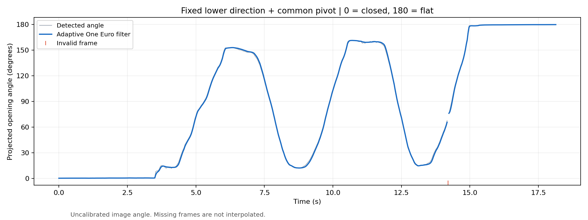
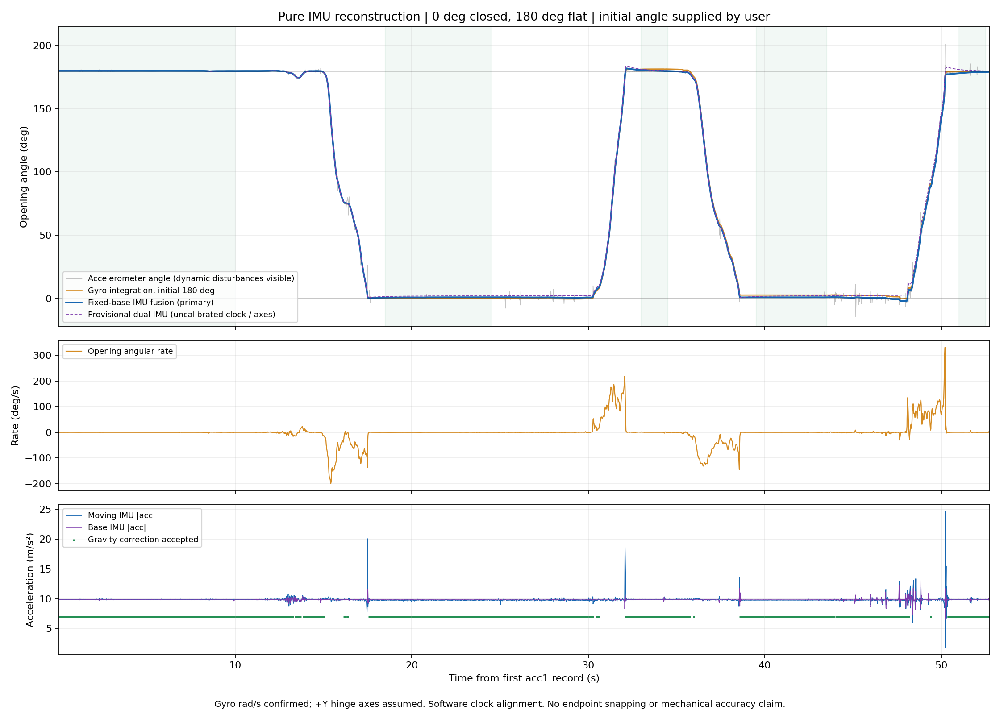

# 折叠手机开合角估计：阶段工作总结与后续路线

**更新日期：2026-10-16**  
**项目目录：** `仓库根目录`  
**文档用途：** 汇总截至当前已完成的视觉测角、IMU 数据分析与角度重建，说明实现细节、实验结果和适用边界，并整理实时融合与减少一个陀螺仪的后续研究路线。

> 当前已经完成固定视角视觉测角和固定底座条件下的 IMU 离线角度重建。两次采集并不同步，尚未实现视觉—IMU 联合融合；任意手持和深度学习减传感器也尚未完成实现与验证。本文中的“有效输出比例”“静止波动”“程序核验”都不能替代真实机械角度精度验证。

## 1. 研究目标与已经确认的条件

### 1.1 角度的定义

本项目统一使用以下开合角约定：

| 手机状态 | 开合角 |
|---|---:|
| 完全闭合 | 0° |
| 半开 | 90° |
| 完全展开 | 180° |

这里关心的是具有机械零位约定的开合角。不能直接取“两条无向直线的锐角”，也不能只取“两面法向量点积的绝对值”，因为这类计算通常会把互补角混为一谈。例如 30° 与 150° 必须能够区分。

视觉中，两条向量均从**铰链端指向各自机身的自由端**。闭合时两者大致同向，展开时大致反向。IMU 中则需要通过安装坐标、铰链轴方向与机械零位，把相对转动映射到同一套 0°—180° 约定。

### 1.2 硬件配置及本次实验约束

用户已确认上下半机身各有一套三轴加速度计 acc 和三轴陀螺仪 gyro，即两套六轴 IMU。gyro 数值单位为 **rad/s**。当前传感器实验中，**主 A+G 所在半机身固定，副 A+G 所在半机身转动**。

CSV 中 `acc1`、`gyro1` 对应副 IMU，中文名称的两路传感器对应主 IMU，这一名称映射由信号变化推断，仍应在采集程序中加入明确设备身份。物理上的主固定、副转动已经得到用户确认。acc 单位根据静止模长推断为 m/s²，尚不是用户独立确认的元数据。

当前视觉实验把相机、下半机身和铰链位置视为固定；录制中的少量误操作位移按局部平移补偿处理。这个约束只针对现有场景，不能直接推广为任意手持条件。

### 1.3 最终希望达到的效果

1. 手机在持续开合过程中，实时输出当前角度，随时可以查询。
2. 整机可以被任意拿起、转动，仍能把整机运动与上下半机身的相对开合分开。
3. 在完整配置下，探索视觉、两套 acc 和两套 gyro 的融合。
4. 后续通过物理模型与深度学习，研究能否移除其中**一整套三轴 gyro**，保留两套 acc 和一套 gyro。

“任意初始角度直接启动”与“从已知初始角度持续跟踪”是两个不同目标，应分别评价。现有 IMU 实验采用已知初始 180°，没有验证任意角度冷启动。

## 2. 输入数据与当前工作状态

### 2.1 输入数据

| 数据 | 路径 | 已知内容 |
|---|---|---|
| 折叠视频 | `data/raw/243eca009e4449f611a92a5437cc4d66.mp4` | 480×256，30 fps，545 帧，约 18.17 秒 |
| 传感器日志 | `data/raw/sensor_log_2026-10-16_09-12-25.csv` | 52,947 行，约 52.71 秒，四路传感器 |

传感器动作说明：从展开 180° 开始，闭合至 0°，保持一段时间，随后往返开合。原始输入文件保持不变。两份数据属于不同次采集，没有可用的同步对应关系，因此不能把两条曲线直接对齐后视为融合实验或相互真值。

### 2.2 已完成与未完成的边界

| 工作项 | 当前状态 | 证据或说明 |
|---|---|---|
| 当前视频逐帧侧边检测及投影角计算 | 已完成 | 标注视频、角度 CSV、曲线、核验记录 |
| 固定下边方向、固定公共交点与视觉平滑 | 已完成 | 稳定版结果与新旧稳定性对比 |
| 针对多场景训练目标检测或关键点网络 | 未完成 | 现有方法使用 OpenCV，不是训练后的神经网络 |
| 相机几何标定与视觉机械角度精度验证 | 未完成 | 当前输出是二维投影角 |
| IMU 去重、时间戳审计与动作分析 | 已完成 | 审计文件、原始信号图 |
| 固定底座 IMU 离线重建 | 已完成初步实验 | 4,354 个逐点输出，含多种估计曲线 |
| 双 IMU 对照曲线 | 已完成初步计算 | 安装轴与时钟映射暂定，不是标定后的手持方案 |
| 实时采集、异步融合与任意手持 | 方案阶段 | 需要采集、标定和在线实现 |
| 同步视觉—双 IMU 融合 | 方案阶段 | 尚无同步数据和融合实验结果 |
| 深度学习减少一个 gyro | 研究路线阶段 | 未训练模型，未测得减传感器性能 |

## 3. 视觉部分：从两条边到逐帧角度

### 3.1 为什么选择这两条边

用户已确认使用“上下半机身靠近相机的长侧边”。这两条边与两块机身的开合方向相关，便于在当前侧视视频中构造铰链端到自由端的向量。

普通目标检测框只能粗略给出手机所在区域，不能直接给出这两条侧边的精确方向。当前实现采用：**首帧手工设置 ROI → 下半机身模板跟踪 → 受约束的 LSD 直线检测 → 上边方向选择与融合 → 计算投影夹角**。没有训练或使用 YOLO。

约束用于减少背景直线、保护壳、反光以及上下边重复选择造成的干扰。近闭合时尤其要避免把下边再次选为上边，否则会产生虚假的 0°。

### 3.2 固定下边与固定交点

根据“下半机身机械上固定、交点尽量不动”的要求，当前稳定版采用：

- 初始化一次下边方向，此后不逐帧重新估计其方向。
- 采用固定虚拟交点，当前视频为像素坐标 **(240, 148)**。
- 每帧检测上半机身侧边方向，并在固定交点处绘制上边模型射线。
- 利用下半机身纹理模板估计小幅平移，画面显示时进行反向补偿。
- 原图中的真实观测线段单独记录，不与稳定画面中的模型射线混淆。

手机有厚度，真实可见的两条边框不一定严格相交。这里固定的是**表达两条方向的公共虚拟交点**，不是要求两条实际轮廓线必须穿过同一个像素。固定交点改善显示和几何约束，但不能自行校正透视误差。

### 3.3 角度计算

设下边单位方向为 u，上边单位方向为 v，两者均从铰链指向自由端：

```text
cross2 = u_x * v_y - u_y * v_x
dot2   = u_x * v_x + u_y * v_y
theta_image = atan2(abs(cross2), dot2) * 180 / pi
```

该定义输出 0°—180°，能区分闭合方向相同与展开方向相反的状态。当前 `projected_angle_deg` 已包含相近上边候选方向的空间融合，但尚未进行时间平滑。只有在选中方向附近约 2.5° 内的兼容线段才参与融合。

### 3.4 视觉用了什么滤波

视觉显示角度使用 **One Euro 自适应低通滤波**。静止时采用较低截止频率抑制抖动；运动时根据角速度估计提高截止频率，使显示尽快跟随开合。

| 参数 | 当前值 | 作用 |
|---|---:|---|
| `min_cutoff_hz` | 0.8 Hz | 静止时的平滑程度 |
| `beta` | 0.1 | 运动时增加跟随速度的强度 |
| `derivative_cutoff_hz` | 1.0 Hz | 速度估计的平滑 |

原始角度、单条选中边的角度与平滑角度分开保存。无效帧角度留空，不插值、不沿用上次角度充当本次测量；出现无效帧后，角度滤波器重置。

### 3.5 当前视觉方案的适用范围

现有首帧 ROI、边框先验和搜索范围针对这段 480×256 视频配置。更换手机、背景、尺寸、拍摄视角后，需要重新初始化并验证。当前只补偿局部平移，没有实现任意相机运动或整机三维旋转下的通用跟踪。

从研究路线看，后续若希望自动适配更多场景，可以训练侧边端点或铰链关键点检测模型；这属于下一阶段，不应把当前受约束直线检测称为已经训练好的目标检测模型。

## 4. 视觉结果、稳定性与验证边界

### 4.1 运行结果

| 指标 | 当前结果 |
|---|---:|
| 视频总帧数 | 545 |
| 有效角度帧数 | 544 |
| 无效帧数 | 1 |
| 有效输出比例 | 99.82% |
| 无效帧号，从 0 开始 | 426 |
| 原始投影角最小值 | 0.1850° |
| 原始投影角最大值 | 179.7668° |
| 固定交点坐标变化范围 | 0 像素 |
| 标注视频实际可解码帧数 | 545 |

**99.82% 是有效输出比例，不是角度准确率。** 固定交点不变化也是模型约束的结果，不是机械定位精度的测量。

时间戳按 `frame_index / nominal_fps` 生成，假设恒定帧率。名义视频时长约 18.1667 秒，最后一帧相对时间戳为 18.1333 秒。标注视频未保留音轨。

### 4.2 相对旧版的稳定性变化

以下对比的是旧版平滑结果与新版平滑结果的**相邻帧角度变化 RMS**：

| 静止窗口 | 旧版 | 固定交点新版 | 降低比例 |
|---|---:|---:|---:|
| 闭合，0—3 秒 | 0.02264° | 0.01803° | 20.4% |
| 展开，15.6—18.1 秒 | 0.06030° | 0.00779° | 87.1% |

这个指标用于观察短时间内显示的细碎跳动。整段窗口标准差还包含慢漂移，不能与帧间抖动混用。例如闭合窗口标准差从旧版约 0.07314° 变为新版约 0.08629°，并没有改善，因此不能声称全部稳定性指标都提高。

在五次 90° 穿越处，平滑曲线相对原始曲线的穿越延迟约 **11—23 ms**。这是本视频内的滤波响应诊断，包含穿越时刻插值计算，不是相机采集、图像处理和显示的端到端延迟，也不是对真实机械动作的延迟测量。

### 4.3 目前不能得出的结论

当前没有相机/运动平面标定，也没有独立机械角度真值。因此输出属于**未经几何标定的二维投影开合角**，不能直接当作真实三维机械角。人工检查图像线段只能检查投影几何是否合理，不能证明机械测角精度。

仅用闭合 0° 和展开 180° 做端点线性缩放，不能保证消除中间角度的透视误差。后续需要合适的侧视几何或投影校正，并用角度夹具、编码器或其他独立参考验证。



## 5. IMU 原始日志：先检查数据，再解算角度

### 5.1 数据结构与完整性

原始 CSV 字段为：

```text
timestamp_ns,delta_ms,sensor,x,y,z,w
```

当前算法读取传感器身份、时间戳和 XYZ。没有把 `w` 当成已经解算好的四元数使用，也没有直接使用手机系统输出的姿态角。记录总数为 52,947 行，覆盖约 52.7100 秒。

### 5.2 重复时间戳与冲突

| 传感器名称 | 原始行数 | 独立时间戳数 | 重复行数 | 同时间戳不同值的时刻数 |
|---|---:|---:|---:|---:|
| `acc1` | 31,517 | 5,046 | 26,471 | 67 |
| `gyro1` | 10,536 | 4,356 | 6,180 | 23 |
| `加速度传感器`，主 acc | 5,627 | 5,627 | 0 | 0 |
| `陀螺仪传感器`，主 gyro | 5,267 | 5,267 | 0 | 0 |

大量重复记录不能当作新增独立测量。本次处理对每路传感器、每个时间戳**保留最后一条数值**，同时记录重复和冲突数量。对于同一时间戳下出现不同 XYZ 的情况，原始采样时间关系已经存在歧义；保留最后一条只是明确的处理规则，不能恢复已经丢失的时序信息。

检查没有发现各路时间戳倒退。纳秒时间戳保持 int64，先减去整数参考时刻，再转换为浮点秒，避免把很大的纳秒整数直接转换为浮点而损失精度。积分使用真实相邻时间差，不使用统一固定 dt，也不直接信任 `delta_ms`。

### 5.3 两种时钟域

两组传感器时间戳量级不同：一组约为 1.79×10¹⁸ ns，另一组约为 4.75×10¹³ ns。不能直接把这些数值相减，或认为同一行附近的记录天然同步。

本次根据 CSV 中相邻记录顺序，拟合了一个临时软件时钟映射。在分别减去各自参考起点、转换为相对秒后：

```text
t_common = a * t_sensor + c
a = 1.00004450674793
c = 0.003502167709346383 s
```

拟合残差的第 5、第 95 百分位约为 −9.03 ms 与 +11.74 ms。这只是该近似配对与拟合的残差，**不是经过独立标定的同步误差界限**。

主结果使用同一时钟域的副 acc 与副 gyro，减少对跨时钟对齐的依赖；暂定双 IMU 曲线则依赖上述映射。CLI 的输出区间仍取四路数据共同覆盖范围。

### 5.4 为什么最后是 4,354 个角度点

去重后副 gyro 有 4,356 个独立时刻。取四路共同时间支持区间后，保留 **4,354 个原始副 gyro 时刻**作为输出时间轴；其余传感器数值离线线性插值到这些时刻。

这些角度点不是 52,947 行原始记录逐行积分的结果。插值也没有提高硬件真实采样率。离线插值可能使用目标时刻之后的样本，因此现有数据预处理不能直接宣称是无未来信息的实时流程。

## 6. 当前 IMU 实现：从原始数值到角度

### 6.1 当前主算法的含义

当前主结果采用**固定底座下，副 IMU 的陀螺积分 + 低动态重力角校正**。这是利用当前场景约束的单自由度估计，不是已经完成的任意手持双 IMU 姿态系统。

处理链如下：

```text
原始 CSV
  → 按传感器分组并审计
  → 同时间戳去重，保留最后一条
  → 建立相对时间与暂定跨时钟映射
  → 取共同支持区间，离线重采样到副 gyro 时刻
  → 初始静止窗口估计零偏和重力参考
  → 陀螺沿铰链轴投影，按真实 dt 梯形积分
  → 低动态且重力可用时进行互补校正
  → 输出角度、各对照估计与质量状态
```

### 6.2 铰链轴与初始角度

副 gyro 的运动主成分方向约为：

```text
[0.0046059, 0.9999638, -0.0071533]
第一主成分能量占比：99.8411%
```

这支持本次把 **+Y 暂定为铰链轴方向**。实际估计中使用 h = (0, 1, 0)，并没有把 PCA 向量直接作为完成标定的轴。主成分分析能够发现主要转动方向，但不能单独确定完整安装关系、机械零位、轴向符号与跨设备一致性。

初始开合角设为 **180°**，依据是用户说明“从完全展开开始”。这是已知初始条件，不是算法独立测得的绝对角。前约 5 秒按初始静止窗口处理，用于零偏和重力参考估计。

### 6.3 陀螺零偏估计

对初始窗口的三轴 gyro 分别取中位数：

```text
bias_xyz = median(gyro_xyz during first ~5 s)
本次约为 [0.0001, 0.0001, 0.0] rad/s
gyro_corrected = gyro_raw - bias_xyz
```

当前零偏只在初始化时估计一次，没有作为状态在线跟踪温漂或慢变偏置。初始窗口也依赖静止假设；它不是已经验证的任意运动启动标定器。

### 6.4 角速度投影与积分

设 h 为副 IMU 坐标中的单位铰链轴：

```text
omega_k = dot(gyro_k - bias, h)
dt_k = t_k - t_(k-1)
theta_pred_k = theta_(k-1) - 0.5 * (omega_(k-1) + omega_k) * dt_k
```

本次约定该轴上的正角速度表示闭合，因此公式使用减号；换安装方向后需要重新确定符号。内部计算使用 rad、rad/s、s，导出时才转为度。积分过程中每一个独立采样都参与更新，不需要等整次开合结束。

纯陀螺积分输出单独保存，便于检查加入加速度校正后究竟改变了什么。陀螺给出角度变化，必须依赖初始角；偏置和噪声会随积分积累。

### 6.5 从加速度构造重力相位角

在低动态时，加速度主要反映重力方向，可以提供不依赖陀螺积分的角度参考。当前固定底座实现以初始副 acc 向量中位数 a0 构造参考：

```text
g0 = norm(a0)
p0 = a0 - dot(a0, h) * h
e1 = p0 / norm(p0)
e2 = -cross(h, e1)
phase_k = atan2(dot(acc_k, e2), dot(acc_k, e1))
theta_acc_k = theta_initial - phase_k
```

这里取的是重力在垂直铰链轴平面中的转动相位。计算后选择与预测角最接近的 2π 分支，避免跨越相位边界时出现不必要的整周跳变。

加速度不只包含重力。整机平移、开合产生的切向和向心加速度、振动都会污染该角度。若铰链轴接近重力方向，垂直于铰链的重力投影很小，重力对开合角的约束也会退化。

### 6.6 互补校正与门控条件

当前使用一阶互补校正，时间常数 τ = 1 秒：

```text
K_k = 1 - exp(-dt_k / tau)
theta_k = theta_pred_k + K_k * (theta_acc_k - theta_pred_k)
```

只有同时满足下列条件，才执行这一步校正；否则保留陀螺传播结果：

| 条件 | 当前阈值 | 目的 |
|---|---:|---|
| 加速度模长相对初始重力模长偏差 | < 0.6 m/s² | 排除部分明显动态加速度 |
| 垂直铰链轴的重力投影模长 | > 0.2g0 | 排除重力几何退化 |
| jerk，加速度变化率模长 | < 30 m/s³ | 排除剧烈变化 |
| 去偏后三轴 gyro 模长 | < 0.25 rad/s，约 14.3°/s | 只在低动态时校正 |
| 加速度角与预测角创新 | < 20° | 拒绝明显不一致观测 |

上述阈值是现有实现的配置与保护条件，未经过多场景最优化。模长接近 g 本身不保证只含重力，需要联合考虑其余条件。

`acc_update_used` 记录进入校正/重初始化分支的状态；首点 dt 为 0 时，标志成立也可能没有非零角度修正，不能简单把标志数等同于实际修正次数。

若相邻时间间隔超过 0.1 秒，当前实现会使状态失效，不跨越大缺口盲目积分。随后需要可靠的低动态重力观测才能恢复。当前实测输出 4,354 行均有效，但这不表示已经验证了各种缺测场景下的恢复性能。

### 6.7 回答“有滤波吗”

**有，但视觉与 IMU 的处理不同。**

| 处理 | 视觉当前实现 | IMU 当前实现 |
|---|---|---|
| 原始信号统一移动平均 | 未作为当前主处理 | 未做原始 acc/gyro 移动平均 |
| 时间平滑 | One Euro 角度滤波 | 陀螺传播与低动态重力互补校正 |
| 初始稳健估计 | 首帧几何初始化 | 初始 gyro/acc 中位数 |
| 异常观测拒绝 | 图像、方向与连续性约束 | 模长、投影、jerk、角速度与创新门控 |
| 卡尔曼滤波 | 未实现 | 未实现 |
| 零相位或前后向平滑 | 未使用 | 未使用 |
| 强制裁剪或吸附端点 | 未使用 | 未使用 |

当前 IMU 不是“先把所有传感器数值低通，再套卡尔曼”。它先用物理关系产生预测和重力观测，再在条件合适时互补校正。离线对齐、初始窗口估计与递推估计应分开理解。

## 7. IMU 最后的结果是什么

### 7.1 输出曲线与动作过程

目前同时输出四类结果：加速度角、纯陀螺积分角、固定底座互补估计角、暂定双 IMU 对照角。依据角速度阈值识别的主要动作区间约为：

| 时间 | 动作说明 |
|---|---|
| 开始阶段 | 展开保持，已知初始 180° |
| 约 13.8 秒 | 短暂调整或扰动 |
| 15.1—17.5 秒 | 第一次主要闭合 |
| 30.3—32.1 秒 | 再次展开 |
| 35.9—38.6 秒 | 第二次主要闭合 |
| 47.6—50.3 秒 | 再次展开 |

这些区间来自实测角速度的阈值检测，不能当作独立机械接触事件标注。



### 7.2 保持窗口统计

以下数值为所选时间窗口内的统计读数，**不是相对独立真值的误差**。单位均为度。

| 窗口 | 时间 s | 固定底座估计中位数 | 固定底座标准差 | 纯陀螺中位数 | 暂定双 IMU 中位数 |
|---|---:|---:|---:|---:|---:|
| 初始展开 | 0—10 | 179.9958 | 0.06305 | 179.9978 | 179.9944 |
| 第一次闭合 | 18.5—24.5 | 0.7949 | 0.06941 | −0.2448 | 1.9023 |
| 中间展开 | 33—34.5 | 180.2049 | 0.23066 | 181.4732 | 180.4990 |
| 第二次闭合 | 39.5—43.5 | 0.8107 | 0.01516 | 2.5880 | 1.9111 |
| 最后展开 | 51—52.5 | 178.9357 | 0.27324 | 179.6563 | 180.3430 |

例如第二次闭合保持时，纯陀螺中位数为 2.5880°，互补估计为 0.8107°，说明加入重力校正确实改变了积分漂移表现。但缺少独立角度参考，不能把差值直接宣称为物理误差降低了多少。

固定底座估计的全程范围约为 **−2.2620°—182.0057°**；纯陀螺积分范围约为 **−0.5465°—181.5133°**。当前没有把这些值强制裁剪为 0°—180°，没有把保持段吸附为端点，也没有按照两端拟合比例系数。保留越界值可以暴露噪声、动态误差、参考偏差和未标定因素。

### 7.3 暂定双 IMU 曲线如何理解

该曲线加入两侧轴向 gyro 差分，并比较两侧重力相位，使用两侧暂定同向 +Y 轴和近似时钟映射。它是供比较的实验输出，不能据此宣称任意手持功能已经完成。

主机身仍存在少量实际运动，安装轴及重力参考没有独立标定，跨时钟也只是近似对齐。因此暂定双 IMU 与主结果可以有偏移；双传感器数量增加本身不保证结果立即更准。

### 7.4 已完成的程序与数据核验

既有核验文件记录：

- 输出 4,354 行，使用严格递增的原始整数时间戳，所有角度数值有限。
- 独立梯形积分与代码的纯 gyro 积分最大差约 3.951×10⁻¹³°，说明积分数值实现一致。
- 既有测试记录为 **22 项测试通过，另有 13 项子测试通过**；其中包含此前视觉测试和新增 IMU 测试。
- 原始 CSV 的 SHA-256 保持为 `c4dcf53900c0295d79c81d95c167020505b77558852de105284bc7b18919a5fc`。

这些证据验证程序与数据处理的一致性，不验证真实机械角度精度。本次编写总结没有重新运行模型或测试，引用的是已保存的核验记录。

## 8. “离散测一次”与“任意时刻有角度”的区别

这里需要区分**数据采样方式**与**估计算法运行方式**。IMU 本来就是离散采样，但算法完全可以逐个事件递推，并持续输出角度，不需要等完成一次开合后才算一个终点值。

当前已经输出 4,354 个角度点，而不是只对每次开合输出一次最终角。现有结果仍然是离线处理，因为先读取完整日志、进行插值，并使用初始静止窗口建立参考。

实时系统可以按以下过程工作：

1. 新 gyro 事件到达时，依据真实 dt 传播当前角度状态。
2. 新 acc 或视觉观测到达时，经过质量判断后校正状态。
3. 查询发生在两次采样之间时，从最近状态短时传播到查询时刻。
4. 同时输出测量时间、状态时间、数据新鲜度和不确定度。

查询时刻的数值是基于最近观测和运动模型的估计。把输出界面刷新得更快，或把曲线插得更密，不会自动获得更高的真实时间分辨率，也不能保证无观测支持时仍无限精确。卡尔曼滤波也不要求按完整动作离散处理，它通常同样按时间逐次预测与更新。

## 9. 任意手持时，物理方案需要怎样升级

### 9.1 为什么副 gyro 单独积分不够

底座固定时，副半机身绕铰链方向的转动主要来自开合。整机被拿起并转动时，副 gyro 同时包含整机公共运动和相对开合；直接积分会把两者混在一起。

完整双 IMU 可以利用铰链约束构造相对角速度，但前提是两侧方向定义、时间和单位一致。

### 9.2 相对角速度模型

设 U 为副/上半机身，L 为主/下半机身；h_U、h_L 分别为同一个物理铰链方向在两侧传感器坐标中的单位向量：

```text
omega_rel = s * [dot(gyro_U - b_U, h_U) - dot(gyro_L - b_L, h_L)]
theta_(k+1) = theta_k + omega_rel * dt
```

s 为标定后的符号，使展开角速度为正。两侧 h 必须指向一致的物理轴向。即使设备轴名称都叫 Y，也不能未经标定直接做 `gyro_U.y - gyro_L.y`。不同时间的两个样本也不能假装同步后直接相减。

正确的轴向投影和差分能够抵消整机公共转动在铰链方向上的分量，留下开合角速度；长期偏置、时间误差、轴误差仍需校正和建模。

### 9.3 完整姿态法与单自由度法

另一个思路是分别估计两侧姿态，再求相对旋转。例如若 R_U、R_L 均将各自机身向量转换到同一世界坐标，则：

```text
R_relative = transpose(R_L) * R_U
```

随后结合铰链轴和机械零位提取开合角。这一路线必须统一坐标定义，不能只用两个估计法向量的无向锐角替代机械角。两个独立六轴姿态滤波器还可能存在相对航向漂移，需要铰链约束或外部观测。

目前任务只需要一个开合自由度，因此已有方案优先采用角度与差分零偏的低维状态，更方便解释、定位问题和实时运行；需要两块机身完整三维姿态时，再考虑更完整的状态表达。

### 9.4 无法靠算法凭空补足的情况

当铰链与重力平行、手机静止且初始角未知时，绕铰链改变开合角可能不改变两侧可见的重力信息，两个 gyro 又都接近零。此时仅凭这些瞬时六轴信号无法唯一恢复绝对开合角，完整双 gyro 也不能独立解决未知初值问题。

已知初始角后连续跟踪，与上述未知角度静止启动不同。后者需要可靠视觉、独立机械状态、可观测的重力关系或其他绝对参考。深度学习可以利用历史和动作先验，但不能保证区分传感器输入完全相同、真实角度却不同的状态。

## 10. 视觉与双 IMU 融合：已有设计，尚未实现

### 10.1 建议的第一版状态

已有融合方案提出单自由度状态：

```text
x = [theta, b_delta]
theta_next = theta + (omega_rel_measured - b_delta) * dt
b_delta_next = b_delta + bias_random_walk
```

`b_delta` 为已经采用统一角度符号后的有效差分 gyro 零偏。若角速度计算已经减去了估计零偏，传播时就不要再次重复减同一个偏置。

可以实现 EKF 等滤波器：gyro 负责高频传播，可靠重力与视觉负责校正，协方差表达传播和观测的不确定度。该状态与滤波器目前仍属设计；当前 `imu_angle.py` 没有实现这套卡尔曼状态和协方差。

### 10.2 视觉应如何进入融合

需要先让视觉测量具备正确几何意义：完成标定后将其作为机械角度观测，或在滤波器中建立从机械角到投影角的观测模型。当前未经标定的二维投影角不能无条件写成 `z_visual = theta`。

建议使用 `projected_angle_deg` 经几何校正后的值，并保留观测质量。该字段已有空间方向融合，尚未时间平滑；不默认把 One Euro 显示输出当作独立新观测，避免重复平滑和额外时间相关性。检测分数需要通过独立数据校准后才能对应观测方差。

视觉结果通常晚于拍摄时刻到达。后续系统应记录曝光时刻，缓存 IMU 与状态历史，在图像对应时间更新后再重放传播至当前时刻。直接把旧图像角度当作“现在”的角度校正，会在快速运动时引入系统误差。

### 10.3 固定图像交点的保留范围

当前固定像素交点与固定下边适用于已有装置。任意手持时，机械铰链仍存在，但它在图像中的位置与下半机身方向都会变化，视觉模型也必须相应跟踪或更新，不能继续冻结为 (240, 148)。

### 10.4 失效时应输出什么

- 视觉遮挡：允许 IMU 短时传播，增大不确定度。
- 重力不可靠：跳过该项校正，不把动态加速度当成角度真值。
- 视觉和重力都不可用：说明处于预测状态并报告漂移风险。
- IMU 长时间中断：标记状态过期，不继续把无限外推当作实时测量。

原融合文档日期为 2026-10-15，开头“尚未取得 IMU 数据”反映当时状态；2026-10-16 已有本文总结的 IMU 采集与离线分析。但**同步融合仍然没有完成**，这一点并未改变。

## 11. 深度学习减少一个 gyro：目标、方法与边界

### 11.1 减掉什么，保留什么

当前完整输入是两套 acc + 两套 gyro，共 12 个原始轴通道。希望减配为两套 acc + 一套 gyro，共 9 个原始轴通道。这里的“减少一个 gyro”是移除其中一侧完整三轴陀螺仪，不是只删掉一个轴。

保留主 gyro 还是副 gyro 尚未决定；视觉是在训练时提供参考，还是部署时继续参与，也尚未决定。这些选择会改变输入可观测性、系统成本和模型的工作条件。

### 11.2 为什么有研究价值，但不能先保证效果

完整双 gyro 直接提供相对角速度所需的两侧转动信息。减少一个后，任意手持时一部分运动分离信息缺失。模型可能利用两侧 acc、剩余 gyro 的历史、铰链约束与动作规律补偿部分缺失信息，但无法保证覆盖所有动作、姿态和初始条件。

现有固定底座日志尤其不能单独证明减 gyro 有效：固定侧 gyro 本来就大多接近零，移除它可能几乎不增加难度。真正有区分度的验证必须让整机运动与相对开合同步发生。

### 11.3 建议的训练与比较路线

1. 先用完整双 IMU 建立标定后的物理基线，并获取同步独立角度参考。
2. 训练时保留全量采集，但对学生模型明确屏蔽目标 gyro；输入只允许使用部署时仍存在的信息。
3. 分别比较“保留主 gyro”和“保留副 gyro”，不要提前假定其中一种必然更好。
4. 候选模型可以采用因果 TCN 或单向 GRU，预测当前角度或物理估计残差；尚未选型、训练和调参。
5. 重建缺失 gyro 可以作为辅助监督，但最终评价目标仍是角度、延迟和稳定性。
6. 完整双 IMU 可提供教师信号，但教师也有漂移与标定误差，不能自动等同于绝对真值。

实时模型必须使用当前及历史输入；不能训练时使用未来样本、双向网络或被移除 gyro 的衍生特征，却在报告中声称部署只需要 9 通道。

### 11.4 数据划分和硬件收益

训练/验证/测试应按完整采集会话、人员、设备等分组。不能把同一段连续信号中高度重叠的滑窗随机拆到训练和测试两边，否则容易高估泛化能力。

当前仅约 52 秒、固定底座的数据不足以证明任意手持模型有效。移除 gyro 是否节省成本或功耗，还要看 acc 与 gyro 是否集成在同一芯片、能否独立关断以及新增计算开销，不能只凭减少输入通道就推断实际硬件收益。

## 12. 下一阶段的数据采集与实验设计

### 12.1 先修复采集质量

| 优先项 | 建议记录或处理 |
|---|---|
| 真实传感器事件 | 按事件写入，避免循环刷新时重复保存缓存值 |
| 身份和单位 | 明确主/副设备、acc/gyro、轴定义与单位 |
| 时间语义 | 硬件采样时间、主机接收时间、时钟域、序号 |
| 两侧同步 | 已验证的公共时钟或明确同步协议与误差评估 |
| 相机同步 | 曝光时间或可标定对应关系，记录帧号与丢帧 |
| 安装标定 | 两侧同向铰链轴、机械零位、gyro 零偏与比例因子 |
| 角度参考 | 已校准编码器、角度夹具或几何标定视觉等独立参考 |

100—200 Hz IMU 与约 30 Hz 视频可以作为采集配置的候选起点，最终依据设备能力、最快开合速度和延迟要求决定；当前没有完成统一采样率与性能指标的需求冻结。

### 12.2 必须覆盖的动作

| 实验 | 主要检查什么 |
|---|---|
| 底座固定，快慢开合与保持 | 与当前工作衔接，观察动态和漂移 |
| 固定某个开合角，整机多方向转动 | 是否误把公共转动当作开合 |
| 整机转动同时开合 | 任意手持的核心能力 |
| 铰链水平、倾斜、接近竖直 | 重力可观测性变化与退化 |
| 不同初始角度开始 | 区分已知初值与未知初值启动 |
| 连续长时间运行、不同温度 | 积分漂移与偏置变化 |
| 快速动作、振动和不同持握位置 | 动态加速度及位置相关影响 |
| 图像遮挡、模糊、IMU 缺测与延迟 | 失效识别、恢复和过期状态 |
| 不同人员、会话和设备 | 深度学习泛化与标定迁移 |

### 12.3 对照组与指标

建议至少比较：完整双 IMU 物理基线、减一个 gyro 的物理基线、减一个 gyro 的学习模型；若部署包含视觉，再增加对应融合组。所有方法尽可能使用同一同步参考、同一数据划分和同一允许延迟。

| 指标 | 含义 |
|---|---|
| MAE、RMSE、P95、最大误差 | 相对独立机械角度参考的误差 |
| 保持段标准差与帧/样本间变化 | 静止波动，需与慢漂移分开 |
| 长时漂移 | 无绝对校正时误差随时间增长 |
| 动态延迟 | 相对参考的时间响应及端到端延迟 |
| 有效输出比例与失效识别 | 不能输出和错误确信的情况 |
| 缺测后恢复时间 | 恢复到可用状态的速度 |
| 推理耗时、内存、实际功耗 | 部署代价与硬件收益 |

目前没有约定“允许误差多少度、允许延迟多少毫秒、最长遮挡多久”等验收阈值。应在建立同步基线后结合应用场景明确，而不是从现有静止波动倒推出精度承诺。

## 13. 当前代码与结果索引

以下链接均指向本机项目中的实际文件；复制整个项目到其他电脑时，应相应更新本文绝对路径。

### 13.1 核心代码与配置

| 文件 | 用途 |
|---|---|
| [README.md](../README.md) | 项目入口与运行说明 |
| [measure_video.py](../measure_video.py) | 视频测角与导出入口 |
| [geometry.py](../fold_angle/geometry.py) | 有向边与角度几何 |
| [detector.py](../fold_angle/detector.py) | 模板跟踪、受约束边线检测 |
| [filtering.py](../fold_angle/filtering.py) | 视觉角度平滑 |
| [sample_video.json](../configs/sample_video.json) | 当前视频固定交点配置 |
| [imu_angle.py](../imu_angle.py) | IMU 去重与单自由度估计 |
| [analyze_imu_log.py](../analyze_imu_log.py) | 离线分析、曲线及报告导出 |
| [inspect_imu_log.py](../inspect_imu_log.py) | 原始日志审计与信号检查 |
| [双 IMU 与视觉融合方案](fusion/dual_imu_visual_fusion_plan.md) | 融合模型、同步和标定设计；非已实现功能 |

### 13.2 视觉输出

| 文件 | 用途 |
|---|---|
| [annotated.mp4](../outputs/fold_angle_fixed/annotated.mp4) | 固定交点稳定版标注视频 |
| [angles.csv](../outputs/fold_angle_fixed/angles.csv) | 每帧角度、线段、配准量与有效状态 |
| [angle_curve.png](../outputs/fold_angle_fixed/angle_curve.png) | 视觉角度曲线 |
| [diagnostics.jpg](../outputs/fold_angle_fixed/diagnostics.jpg) | 多时刻叠加检查图 |
| [summary.json](../outputs/fold_angle_fixed/summary.json) | 配置与运行统计 |
| [stability_comparison.json](../outputs/fold_angle_fixed/stability_comparison.json) | 新旧稳定性及滤波响应统计 |
| [verification.json](../outputs/fold_angle_fixed/verification.json) | 输出完整性与几何核验记录 |

此前旧版结果保留在 `../outputs/fold_angle/`，不是当前默认稳定版。

### 13.3 IMU 输出

| 文件 | 用途 |
|---|---|
| [angles.csv](../outputs/imu_20261016_091225/angles.csv) | 4,354 个时刻的逐点角度和质量状态 |
| [angle_curve.png](../outputs/imu_20261016_091225/angle_curve.png) | 四种估计曲线对比 |
| [raw_signals.png](../outputs/imu_20261016_091225/raw_signals.png) | 三轴原始信号诊断 |
| [report.md](../outputs/imu_20261016_091225/report.md) | 本次纯 IMU 分析简报 |
| [data_audit.json](../outputs/imu_20261016_091225/data_audit.json) | 数据重复、冲突和时序审计 |
| [summary.json](../outputs/imu_20261016_091225/summary.json) | 参数假设、窗口统计与结果 |
| [verification.json](../outputs/imu_20261016_091225/verification.json) | 时间戳、数值积分和测试记录 |

## 14. 关键 CSV 字段怎样使用

### 14.1 视觉 CSV

| 字段 | 解释与使用建议 |
|---|---|
| `frame_index`、`timestamp_s` | 从 0 开始的帧号、按标称 fps 计算的时间 |
| `projected_angle_deg` | 兼容线段空间融合后的角度，无时间平滑；无效时为空 |
| `selected_edge_projected_angle_deg` | 单条实际选中上边相对固定下边的角度 |
| `smoothed_projected_angle_deg`、`stabilized_projected_angle_deg` | 相同的 One Euro 显示角度 |
| `valid`、`failure_reason` | 是否可用以及拒绝原因 |
| `support_score` | 启发式图像支持分数，不是概率或精度 |
| `fusion_count` | 参与兼容方向融合的线段数量 |
| `observed_lower_*`、`observed_upper_*` | 原图坐标中的实际观测，缺观测时为空 |
| `lower_*`、`upper_*` | 稳定坐标中的模型射线，其夹角对应显示角度 |
| `hinge_anchor_*` | 固定虚拟交点 |
| `registration_dx`、`registration_dy` | 相对参考画面的平移，显示时取负补偿 |
| `interpolated` | 当前始终为 0，没有填补无效角度 |

融合研究应优先考虑经几何校正的时间未平滑观测；看稳定视频则使用平滑列。两者用途不同。

### 14.2 IMU CSV

| 字段 | 含义 |
|---|---|
| `timestamp_ns`、`time_s` | 原始副 gyro 整数时间戳及相对秒 |
| `acc_angle_deg` | 由重力相位构造的角度，不保证动态时可靠 |
| `gyro_integrated_angle_deg` | 去初始零偏后的纯陀螺积分 |
| `fixed_base_imu_angle_deg` | 当前固定底座主结果，互补校正估计 |
| `provisional_dual_imu_angle_deg` | 暂定双 IMU 对照，标定与同步未完成 |
| `angular_rate_deg_s` | 以展开为正的轴向角速度 |
| `acc_update_used` | 本点进入加速度校正或恢复分支的标志 |
| `acc_quality`、`low_motion` | 加速度观测条件与低动态条件 |
| `valid` | 估计状态是否有效 |
| `acc_norm_m_s2`、`base_acc_norm_m_s2` | 副、主加速度模长诊断 |

## 15. 复现命令

以下命令供复现已有结果。本次总结编写未重新运行这些命令。**重复执行会覆盖所指定输出目录的同名结果**；要保留现有结果，可另选新的输出目录。

```powershell
Set-Location '<repo-root>'

# 视觉固定交点版本，ROI 只针对当前视频
python measure_video.py --video 'data/raw/243eca009e4449f611a92a5437cc4d66.mp4' --config configs/sample_video.json --output outputs/fold_angle_fixed

# IMU 离线重建
python analyze_imu_log.py --input 'data/raw/sensor_log_2026-10-16_09-12-25.csv' --output outputs/imu_20261016_091225

# 项目测试
python -m pytest tests -q
```

## 16. 当前结论与下一步交付顺序

当前已经证明：在给定固定场景下，能够从两条侧边逐帧计算稳定的二维投影角；在当前主固定、副转动的日志中，能够完成数据审计、去重和逐时刻 IMU 角度重建，并输出可追溯的中间量与状态。

当前尚未证明：真实机械角度的全程精度、任意手持时的稳定实时效果、视觉—双 IMU 同步融合效果，以及减少一个 gyro 后的泛化性能。

建议下一步交付按依赖关系推进：

1. **规范采集与标定记录。** 修复缓存重复写入，确认时钟、设备身份、两侧铰链轴和零位。
2. **采集同步基线数据。** 同时记录完整双 IMU、视频和独立角度参考，覆盖固定与手持动作。
3. **建立完整双 IMU 的实时物理基线。** 逐事件传播、门控校正、报告失效与不确定度，再加入视觉延迟更新。
4. **开展减一个 gyro 的公平实验。** 分别保留主/副 gyro，先做物理基线，再训练因果学习模型，使用独立会话测试。

本文是对现有本地代码、输出与讨论的阶段性整理；没有新增模型性能结果，也没有用文献、示意图或算法一致性检查替代独立实测精度。
