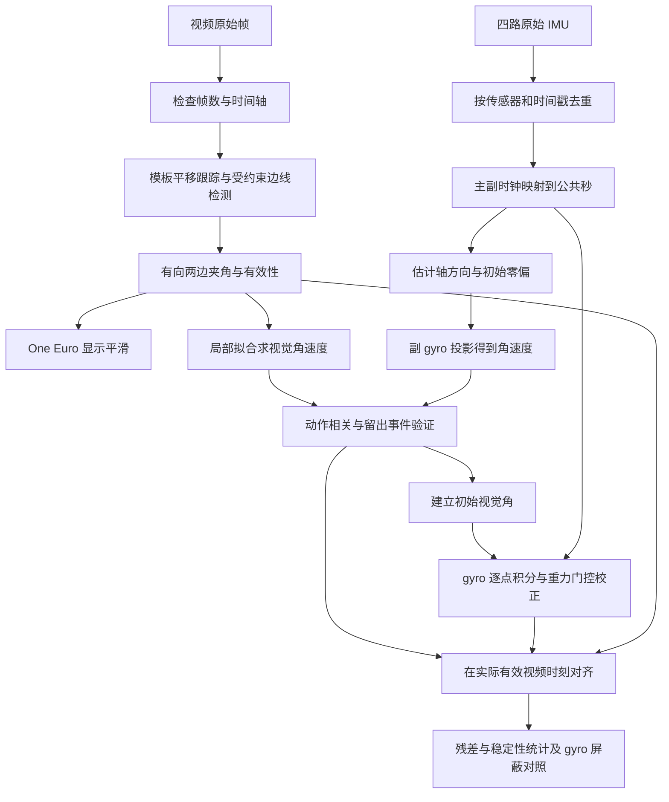

# 折叠手机测角：从原始采集到最终结果的逐步原理说明

如果需要从 CSV 表头、原始行、模型参数和逐点状态开始理解，请先读[CSV到下一条IMU数据的完整计算教程](从原始CSV到下一条IMU数据_完整计算教程.md)，其中完整演算连续三点，并说明新CSV如何复用算法。

日期：2026-10-16。对应已完成实验 `experiment_20261016_110453`。

这份文档解释“每一步为什么做、具体怎么算、会引入什么假设、实际算出了什么”。所有标为“本次实算”的数值来自本次日志、配置和已导出的结果；公式示例没有替代实测数据。结果概览另见[实验报告](../outputs/experiment_20261016_110453/report.md)。

原始输入：

- 视频：`data/raw/1016110453.mp4`。
- 四路惯性数据：`data/raw/sensor_log_2026-10-16_11-04-53.csv`。
- 角色：A 为主机身，本次基本固定；B 为副机身，本次转动。
- 定义：闭合 0°、半开 90°、展开 180°。

## 1. 先理解我们究竟在估计什么

### 1.1 角度是随时间变化的状态，不只是一次动作的终点

目标是得到开合角函数 θ(t)。传感器实际上提供离散样本，例如每隔约 10 ms 测一次角速度。算法每收到一次样本就更新一次角度，不需要等一次开合结束。因此应区分：

1. **采集是离散采样**：所有数字传感器都如此。
2. **只记录每次最终角度**：是一种稀疏实验设计，不是惯性解算必须如此。
3. **逐采样递推角度**：本次已经做到，输出 4085 个原生副 gyro 时刻的角度。
4. **任意查询时刻的角度**：离线可以在有数据支持的短间隔内插值；在线可以从最近状态向查询时刻作短时预测，但它不是该时刻新的独立测量。

卡尔曼滤波不是把离散终点“变成连续曲线”的工具。它是根据运动模型、观测和不确定性递推状态的一种方法。本次使用的是**带条件的互补校正**，没有实现卡尔曼滤波。

### 1.2 本次有两种角度，含义不同

视觉看到的是两条长侧边在图像中的夹角，记为 θv；IMU 估计的是在单自由度铰链、安装轴和初值假设下的开合角，记为 θimu。

正侧视、相机几何合适时，θv 可接近机械开合角；任意斜视时，透视会改变夹角。平面投影通常不保角，所以本次 θv 仍称“二维投影参考”，尚无独立机械真值。后面的 0.669° 是相对这个参考的平均绝对残差，不能直接解读为产品机械精度。

### 1.3 整条处理链



One Euro 这条支路用于显示；同步和残差使用原始视觉角。视频与 IMU 先利用**角速度形状**对时，再利用同步起点附近的视觉角初始化 IMU，之后没有持续视觉角更新。

## 2. 第一步：原始记录分别代表什么

### 2.1 视频帧

输入是 1280×720、30 fps 的视频。实际成功解码 1421 帧，末帧编号 1420。使用：

$$t_v(k)=k/30.$$

第 300 帧对应 10.0 s；末帧对应 47.333333 s。1421/30=47.366667 s 是按帧时长算的总时长，二者差一帧并不矛盾。

OpenCV 的播放时间戳与此时间轴一致。这里验证的是解码/播放时序，不是曝光硬件时序，无法据此证明相机采集端绝无掉帧。

输出依据：[视频审计](../outputs/experiment_20261016_110453/video/data_audit.json)、[逐帧时间](../outputs/experiment_20261016_110453/video/frame_timestamps.csv)。

### 2.2 Gyro 是角速度，不是角度

陀螺仪测量模型为：

$$\boldsymbol\omega_m=\boldsymbol\omega+\mathbf b_g+\mathbf n_g.$$

ωm 是传感器三轴读数，ω 是实际角速度，bg 是零偏，ng 是噪声。单位 rad/s 已由用户确认。要得到转过多少角，必须结合时间积分；仅凭某一行 gyro，无法直接知道当前是 30° 还是 150°。

### 2.3 Acc 也不是直接输出角度

加速度计测量的是比力，常见约定下：

$$\mathbf a_m=R^T(\mathbf a_{world}-\mathbf g)+\mathbf b_a+\mathbf n_a.$$

R 将机身坐标转到世界坐标。静止时，世界平动加速度近零，读数主要反映重力在传感器坐标中的方向；运动时还会混入平动、转动造成的切向和向心加速度、碰撞等影响。不同硬件符号约定可能不同，本次使用实际初始参考，不直接假定某个轴一定为 +9.8。

Acc 的 m/s² 单位依据静止模长约 9.8 推断。本次副 acc 出现过 z≈−51.7479 m/s² 的冲击值，这种读数不能直接当作重力方向求角。

四路字段对应关系：

| 角色 | Acc 字段 | Gyro 字段 | 当前身份依据 |
|---|---|---|---|
| 主 A，基本固定 | 加速度传感器 | 陀螺仪传感器 | 用户确认主侧固定，结合时钟分组和信号行为推断字段配对 |
| 副 B，开合转动 | acc1 | gyro1 | 副 gyro 显著运动、重力方向随开合变化 |

这不是完整安装标定；后续采集最好直接记录设备 ID、机身角色、安装方向和时间戳语义。

## 3. 第二步：去重清理，避免把缓存写入当作新采样

### 3.1 为什么不能逐 CSV 行直接积分

CSV 有多路交错记录，同一路还可能重复写入同一个时间戳。如果把每一行都当成新的采样，样本数、采样率和积分结果都可能错误。

本次按 `(sensor, timestamp_ns)` 分组，每组保留日志里最后一条。先检查各路有无时间倒退，再输出唯一、递增的原始采样时刻。相同时间戳但不同值被记录为冲突；keep-last 是明确的有损处理，无法恢复哪个读数才对应真实采样。

| 数据流 | 原始行 | 唯一采样时刻 | 重复行 | 冲突时刻 | 采样间隔中位数 / 最大值 |
|---|---:|---:|---:|---:|---|
| Acc A | 4956 | 4956 | 0 | 0 | 8.0025 / 27.9853 ms |
| Gyro A | 4461 | 4461 | 0 | 0 | 9.9989 / 12.9984 ms |
| Gyro B | 4461 | 4086 | 375 | 9 | 12 / 52 ms |
| Acc B | 4428 | 4102 | 326 | 6 | 12 / 91.0001 ms |

总计 18306 行，清理后 17605 行。去重不等于低通滤波；保留下来的读数没有因此被平均或平滑。

### 3.2 本次实算：一组冲突

副 gyro 时间戳 `1792119897253000000 ns` 有以下两条记录，按日志顺序为：

```text
(-0.0162, -2.5690, 0.0101) rad/s
(-0.0124, -2.3666, 0.0090) rad/s
```

本次保留第二条。不能把它们当作两个不同时间点，也没有凭空给它们补一个采样时间间隔。

输出：[cleaned_imu.csv](../outputs/experiment_20261016_110453/imu/cleaned_imu.csv)。代码：`imu_angle.py::read_log`。

## 4. 第三步：把主副 IMU 的两个时钟放到一起

### 4.1 为什么不能直接相减原始时间戳

副侧时间量级约 1.79×10¹⁸ ns，主侧约 5.42×10¹³ ns。它们的起点不一样，不能直接相减解释成物理延迟。另一个问题是，巨大整数直接转浮点会损失低位精度。

先在整数域相减，再换秒：

$$t_B=(T_B-T_{B0})/10^9,\qquad t_A=(T_A-T_{A0})/10^9.$$

本次参考点：

```text
T_B0 = 1792119894952000000 ns
T_A0 =      54192337235780 ns
```

### 4.2 主副时钟映射怎样估计

CSV 行序提供了软件记录顺序。对于一条主侧记录，寻找其前后副侧记录，把前后副侧时间的中点作为近似对应时间，只使用前后跨度小于 25 ms 的括号做拟合：

$$t_{common}=c\,t_A+d.$$

采用 `soft_l1` 鲁棒损失拟合，尺度参数 5 ms，降低异常行序对应的影响。得到：

$$t_{common}=1.000013369374\,t_A-0.014183239064.$$

副侧相对秒直接作为公共时间。映射残差 P5/P50/P95 约 −7.237/−0.078/+7.897 ms。

**物理含义**：这是日志行序下的近似时钟换算，不是硬件同步。行写入可能有缓存和调度延迟，拟合残差也不是独立测得的真实时间误差。这里的系数 c 与后面“视频对 IMU”的系数 a 是不同映射，不能混用。

代码：`analyze_imu_log.py::infer_clock_map`；本次入口 `analyze_synchronized_experiment.py` 保存映射到 IMU summary。

## 5. 第四步：视觉如何从像素变成两条边的角度

### 5.1 初始化定义测量对象

本次单独初始化固定机身模板框 `[550,309,826,333]`、下边参考 `[(540,313),(826,314)]`、虚拟铰链点 `(540,305)`，参考边长 290 px。它们提供搜索区域、几何尺度和固定参考，不是每帧手动标角。

当前实现是 **OpenCV 模板跟踪＋受约束 LSD 直线段检测**，没有训练 YOLO 或端到端角度网络。普通目标框只能定位手机，不能直接提供足够准确的长侧边方向。

### 5.2 为什么先跟踪底座

即使机械底座固定，误碰相机也会让画面平移。模板跟踪在局部区域寻找底座图像，使用去均值归一化相关：

$$\rho=\frac{\sum_p(T_p-\bar T)(I_p-\bar I)}{\sqrt{\sum_p(T_p-\bar T)^2\sum_p(I_p-\bar I)^2}}.$$

T 是初始化模板，I 是候选图像块。当前采用 `TM_CCOEFF_NORMED`，正常局部搜索范围 ±30/±18 px，阈值 0.55；丢失后会扩大搜索。匹配给出 dx、dy，用于把观测与显示恢复到稳定坐标。

这里补偿的是平移，不能纠正任意相机旋转、缩放或视角变化。分数是图像相似度，不是“角度正确概率”。

### 5.3 为什么检测到直线后还要筛选

LSD 根据局部灰度梯度提取近似共线的像素支持区，输出许多线段。桌边、反光和手机其他边缘都可能被检测到。因此还要使用本次几何和外观约束：

| 条件 | 本次数值 | 目的 |
|---|---|---|
| 长度 | 0.55L～1.18L，L=290 px | 排除短碎线与明显不符的长线 |
| 线到铰链的垂直距离 | ≤0.11L | 只保留可能属于机身长侧边的线 |
| 近端沿线偏移 | −0.18L～0.26L | 容忍厚度、端点分裂，但不接受任意远处的边 |
| 自由端所在半平面 | 标准化画面中的上侧容差 0.12L | 排除桌下反射等候选 |
| 暗色支持 | ≥0.86 | 检查边附近是否有手机暗色边框支持 |
| 时间连续性 | 常规每帧变化 ≤24°，短时丢失后放宽 | 抑制误跳到另一条边 |

暗色支持在沿线 12%～90% 的 50 个位置采样，同时检查法向偏移 −4、−2、0、2、4 px。亮度 <95 且 BGR 三通道极差 <55 视作暗色支持；每个沿线位置只要某个法向偏移满足即可。

初始候选分数为：

$$q=0.5\min(\ell/L,1)+0.35\,dark\_support+0.15\,proximity.$$

之后还有连续性等扣分，支持阈值为 0.55。接近闭合时，特别排除把下边自己再选一次当作上边；上边需有独立、位于下边上方的线支持。最终将方向距选中边 ≤2.5° 的候选进行加权融合，权重为 `线长 × q²`，减少同一边多个像素轮廓造成的抖动。

因此 CSV 中“原始投影角”表示**未做时间平滑的多候选方向结果**，不一定等于某一条原始 LSD 线段的角度。

### 5.4 为什么必须使用从铰链指向自由端的向量

定义下边向量 u 和上边向量 v，两者都从铰链方向指向各自自由端：

$$\theta_v=\operatorname{atan2}(|u_xv_y-u_yv_x|,u_xv_x+u_yv_y)\,180/\pi.$$

同向时为 0°，反向时为 180°。不能用 `acos(|u·v|/(|u||v|))`，后者会把 150° 变成 30°。也不能随意交换线段端点，否则会改变向量方向。

**本次实算，第 0 帧**：从导出坐标得到：

```text
u = (289.998,   1.014)
v = (220.065, -144.306)
```

代入公式得到 33.454902°，与保存的选中单边角 33.45483° 一致到坐标导出舍入范围。3 条方向相近的候选融合后，原始视觉输出是 33.52841°。这两个值用途不同，差异不是后面滤波造成的。

### 5.5 固定交点为什么能减抖，又为什么不是增加了观测信息

下边方向只初始化一次，模型射线始终共用虚拟点 `(540,305)`。上边更新方向，显示射线从这个点出发。这样减少了逐帧拟合下边和两线交点引入的随机变化；尤其接近平行时，真实线交点对微小像素误差非常敏感。

但固定虚拟点是机械约束和显示模型，不是声称厚边框的两条实际轮廓必然精确相交。CSV 将 `observed_*` 实际观测与模型射线分开存储。画面中的红绿射线看起来稳定，也不能独立证明测量更准确。

新画面与旧画面的左右方向相反，本次内部先按 `x'=1279−x` 镜像为旧模块的标准方向，再将边线和位移还原。镜像保持夹角大小，但改变叉积符号，因此方向绘制也必须还原。

### 5.6 无效数据怎么处理

1421 帧中 1118 帧有效，303 帧无效：126 次角度不连续、169 次找不到上边、8 次模板丢失。角度留空，不补成 0°，不拿上一帧伪装本帧观测。

78.68% 表示视觉输出可用比例；不是角度准确率。

代码：[detector.py](../fold_angle/detector.py)、[geometry.py](../fold_angle/geometry.py)。输出：[video/angles.csv](../outputs/experiment_20261016_110453/video/angles.csv)。

## 6. 第五步：视觉的 One Euro 滤波具体做了什么

像素边缘会受反光和检测误差影响，角度静止时也会小幅变化。固定低通能减抖，却会让快速开合明显滞后。One Euro 根据变化速度调整低通截止频率：

$$d_k=(x_k-x_{k-1})/\Delta t,$$

$$\alpha(f,\Delta t)=\frac{2\pi f\Delta t}{1+2\pi f\Delta t},$$

$$\hat d_k=\hat d_{k-1}+\alpha(f_d,\Delta t)(d_k-\hat d_{k-1}),$$

$$f_k=f_{min}+\beta|\hat d_k|,$$

$$\hat x_k=\hat x_{k-1}+\alpha(f_k,\Delta t)(x_k-\hat x_{k-1}).$$

这里 x 是角度，单位 °。本次 `f_min=0.8 Hz, beta=0.1, f_d=1 Hz`，beta 的数值与这里角度单位有关。静止时截止频率低、平滑更强；快速转动时截止频率升高、响应更快。

**本次实算**：第 0 帧原始 33.52841°，第 1 帧原始 33.51302°，滤波后第 1 帧约 33.526183°。滤波器只向新观测靠近一部分。遇到无效帧就重置，重新有效时从新观测启动。

这是一种因果低通，仍可能有响应延迟。为避免显示平滑影响同步和评价，本次对时、残差使用原始视觉输出。代码：[filtering.py](../fold_angle/filtering.py)。

## 7. 第六步：IMU 的铰链轴、零偏和初始参考怎么得到

### 7.1 为什么三轴要投影到铰链轴

理想折叠机构主要有一个相对转动自由度，不需要将三轴角速度模长直接当作开合速度。若单位铰链轴在本机坐标为 h，则轴向速度为：

$$r=(\boldsymbol\omega_m-\mathbf b_g)\cdot\mathbf h.$$

使用模长会丢失开启/闭合的正负号，还会混入其他方向的运动。本次开启对应副侧轴向速度为负，因此开合角速度为 `−r`。

### 7.2 本次怎样确认 +Y，而不是照抄旧实验

先使用保留的 Acc B，在模长 9.2～10.4 m/s²、jerk<15 m/s³ 的样本上，减去中位参考，进行 SVD 平面拟合。固定底座开合时，重力向量在 B 坐标中主要沿垂直铰链轴的平面变化。**最小奇异值对应的方向**是该平面的法向，得到：

```text
h_acc ≈ (0.002375, 0.999995, -0.001836)
```

算法本次取其主坐标方向 `hB=(0,1,0)`。另用活跃副 gyro 的 SVD 检查，**最大奇异值对应的方向**为：

```text
h_gyro ≈ (0.002046, 0.999965, -0.008168)
主方向能量占比 ≈ 99.9319%
```

两种证据一致支持 Y 轴。方向正负再结合开合动作核对。两种 SVD 一种取最小方向、一种取最大方向，原因分别是“平面法向”和“主要运动方向”，不能弄反。

Acc 平面估计使用了本次整段数据，是离线标定。它不说明设备开机时可以立即自动完成轴标定。主侧运动不足，本次 `hA=(0,1,0)` 仍是暂定安装约定；任意手持前应分别标定两侧同向的物理铰链轴。

### 7.3 零偏为什么很重要

静止时 gyro 也常有非零输出，积分会把这个偏移累计成角度漂移。本次取前 0～1 s 的三轴中位数：

```text
bB = ( 0.00345, 0.00020, -0.00085) rad/s
bA = (-0.00245, 0.00155, -0.00030) rad/s
```

中位数可减小短时异常点影响，但只有该窗口真正接近静止时，才是可靠零偏估计。本次前 1 s 的副 Y 标准差约 0.0571 rad/s，表明存在轻微运动，不能把该估计视为精密标定。

恒定轴向零偏误差 Δb 积分 T 秒会产生约 `Δb×T` 弧度误差。本次用前 0.5 s 估出的副 Y 中位数为 0.00325，较正式采用的 0.00020 大 0.00305 rad/s；若换用它，44.676 s 后纯积分末值会改变约 +7.806°。这项敏感性诊断没有被用来回调正式结果。

零偏在基线入口减一次，再显式告诉底层估计器零偏已扣除，避免重复相减。

### 7.4 初始角从哪里来

Gyro 积分提供的是角度变化量 Δθ，必须知道 θ0 才能得到绝对读数。Acc 初始参考也只定义相对相位，不自动提供机械零位。

本次先完成运动信号对时，再取视频约 1.233333～1.6 s 内的原始角中位数：

$$\theta_0=33.253755^\circ.$$

本次起始不是完全展开，不能套用旧实验的 180°。所有 IMU 方案共享这个视觉初值，所以后续对照不是完全独立的绝对初始化验证；之后则没有继续接收视觉角校正。

参数来源：[imu/summary.json](../outputs/experiment_20261016_110453/imu/summary.json)。

## 8. 第七步：把轴向角速度逐点积分为角度

### 8.1 对齐采样与插值的原理

四路采样不同步，不能直接把第 n 行 A 与第 n 行 B 相减。本次主要结果在 B gyro 的真实唯一时刻更新，其余流在相邻有效样本间线性插值：

$$y(t)=y_i+\frac{t-t_i}{t_{i+1}-t_i}(y_{i+1}-y_i).$$

只有短间隔内近似线性才合理。当前插值最大括号间隔：Acc B 0.10 s、Acc A 0.06 s、Gyro B 0.06 s、Gyro A 0.04 s；不做区间外外推。缺失不是 0。IMU 估计器自身也将超过 0.1 s 的积分间隔判为无效，并仅在可靠重力条件下恢复融合角。

四路公共范围内有 4085 个 B gyro 时刻；这不等于把四路所有数据都重采样成某个假定固定频率。

### 8.2 梯形积分

连续关系是 `dθ/dt=−r`。在两个样本之间假设角速度近似线性，用梯形积分：

$$\Delta\theta_k=-\frac{r_{k-1}+r_k}{2}\Delta t,$$

$$\theta^-_k=\theta_{k-1}+\Delta\theta_k.$$

θ⁻ 表示还未使用 Acc 修正的预测角。内部使用 rad，输出乘 180/π。实际 dt 每次从时间戳相减，不能都写死 0.01 s。

**本次实算，前两个采样点**：

| 项目 | t=0 s | t=0.013 s |
|---|---:|---:|
| 原始 Gyro B 的 Y，rad/s | 0.0418 | 0.0349 |
| 减 Y 零偏 0.0002 后，rad/s | 0.0416 | 0.0347 |

所以：

$$\Delta\theta=-\frac{0.0416+0.0347}{2}\times0.013\times180/\pi=-0.028415842^\circ,$$

$$\theta^-=33.253755-0.028415842=33.225339158^\circ.$$

这就是该时刻纯 gyro 的积分读数。注意本例前一点还没有积累校正，因而纯 gyro 值与互补算法的本步预测相同；后续互补算法会从自己的上一融合状态预测，不会每次都回到纯积分曲线上。

## 9. 第八步：Acc 如何变成可用于校正的角度

### 9.1 不是对两个原始 Acc 直接求夹角

两套传感器坐标系不同，运动中又有非重力加速度。直接 `acos(accA·accB/(|accA||accB|))` 一般不能作为开合角算法。

本次利用单自由度模型，在垂直铰链轴的平面内计算**重力相位**。

设初始窗口 Acc 中位向量为 a0，构造：

$$p_0=a_0-(a_0\cdot h)h,\quad e_1=p_0/\|p_0\|,\quad e_2=-h\times e_1.$$

e1、e2 是垂直铰链轴平面中的两个单位方向。当前加速度在这两个方向的投影给出相位：

$$\phi_k=\operatorname{atan2}(a_k\cdot e_2,a_k\cdot e_1).$$

固定底座条件下：

$$\theta_{acc,k}=\theta_0-\phi_k.$$

这里 θ0 和 φ 计算时使用一致的 rad 单位。`atan2` 自带正负象限，优于只用 cos 求锐角。对于跨越 ±π 的分支，选择距预测角最近的 2π 等价分支，避免人为出现 360° 跳变。

### 9.2 为什么有些姿态重力无法测开合

定义投影可观测性指标：

$$o_k=\|a_k-(a_k\cdot h)h\|/g_{ref},\qquad g_{ref}=\|a_0\|.$$

铰链接近竖直、与重力平行时，平面投影很小，开合转动几乎不改变重力读数；这时 Acc 无法稳定判断开合角。本次要求 o>0.2 才参与校正。加速度模长接近 g 也不是重力可信的充分条件，因此还需要动态门控。

### 9.3 本次实算：同一个 0.013 s 采样点

算法在 gyro 时刻插值得到：

```text
初始重力参考 a0 ≈ (-5.3909, 0.0160206, -8.2248) m/s²
g_ref ≈ 9.834093 m/s²
当前 Acc B       = (-5.3598, 0.0095,    -8.2942) m/s²
phi             = 0.006486419 rad
```

于是：

$$\theta_{acc}=33.253755-0.006486419\times180/\pi=32.882110594^\circ.$$

这个读数比 gyro 预测低约 0.343229°。不能立刻认定 Acc 一定更正确，需要检查是否允许它参与更新。

## 10. 第九步：为什么有时校正、有时只积分

### 10.1 重力校正的门控条件

固定底座算法只在下列条件全部通过时，才用 Acc 修正角度：

| 条件 | 公式/阈值 | 意义 |
|---|---|---|
| 模长近似重力 | `abs(|a|−g_ref)<0.6 m/s²` | 排除明显平动/冲击 |
| 投影足够大 | `o>0.2` | 避免铰链接近竖直时的退化 |
| 加速度变化不剧烈 | `jerk=|a_k−a_(k−1)|/dt<30 m/s³` | 排除快速扰动 |
| 旋转不快 | `|gyro−bias|<0.25 rad/s` | 更保守地只在低动态使用重力 |
| Acc 与预测不明显矛盾 | `abs(theta_acc−theta_pred)<20°` | 拒绝不可信的大幅拉动 |

这些是物理启发的工程门限，不是统计意义上的可信概率。它们会牺牲一部分可校正时刻，也不能保证所有通过的 Acc 都没有动态污染。

### 10.2 互补校正公式

通过门控时：

$$K_k=1-e^{-\Delta t/\tau},\qquad\tau=1\ \mathrm{s},$$

$$\theta_k=\theta^-_k+K_k(\theta_{acc,k}-\theta^-_k).$$

未通过时：

$$\theta_k=\theta^-_k.$$

解释：短时变化主要靠 gyro 跟踪；低动态下再慢慢向重力角靠近，抑制积分长期漂移。τ 大时校正更慢，τ 小时更容易受 Acc 扰动影响。它没有显式传播协方差 P，也没有按 Q、R 求增益，因此不是本次已经实现了卡尔曼滤波。

### 10.3 本次实算：允许校正的完整一次更新

仍看 0.013 s：

```text
模长偏差   = 9.875287−9.834093 = 0.041194 m/s² < 0.6
投影比例   = 1.004188 > 0.2
jerk       = 6.433810 m/s³ < 30
gyro 模长  = 0.035130 rad/s < 0.25
创新       = 32.882110594−33.225339158 = -0.343228564°
K          = 1−exp(-0.013/1) = 0.012915865
```

最终：

$$\theta=33.225339158+0.012915865\times(-0.343228564)=33.220906064^\circ.$$

这与 `imu/angles.csv` 对应行保存的 `33.22090606435732` 一致。由此可以追溯：原始 gyro→扣零偏→投影→按真实 dt 积分→Acc 相位→质量门控→小比例修正→本行输出。

### 10.4 本次实算：拒绝 Acc 校正的一次更新

在 t=2.003 s：

```text
上一时刻             = 1.9820001 s
上一融合角           = 35.870091055°
本步 gyro 积分增量   = +0.406924148°
预测角               = 36.277015203°
Acc 观测角           = 35.048523661°
去偏 gyro 模长       = 0.424376 rad/s > 0.25
```

虽然本点 Acc 模长、投影、jerk 条件通过，旋转速度门限未通过，因此输出仍为 **36.277015203°**，不向 35.048524° 拉动。这就是 CSV 中 `acc_update_used=0` 的具体意义。

首点 dt=0 即使记录了更新标志，增益也为 0，不能据此认为发生了非零校正。固定底座本次记录 2347 个更新标志。

代码：[imu_angle.py](../imu_angle.py) 的 `_gravity_phase`、`estimate_angle`。

## 11. 第十步：双 IMU 与减少一组 Gyro 的具体差别

### 11.1 双 gyro 为什么能够去除整机公共转动

若两侧铰链轴 hA、hB 已标定为同一个物理有向轴，且采样已同步，理想铰链的相对角速度为：

$$\dot\theta=-\left[(\omega_B-b_B)\cdot h_B-(\omega_A-b_A)\cdot h_A\right].$$

同一整机转动在两侧轴投影中是公共分量，相减后抵消；B 相对于 A 的铰链转动保留下来。注意两侧原始 XYZ 不一定同向，不能在未标定情况下盲目逐轴相减。

两侧 Acc 分别建立重力相位后，暂定双 IMU 使用：

$$\phi_{rel}=\operatorname{atan2}(\sin(\phi_B-\phi_A),\cos(\phi_B-\phi_A)),$$

$$\theta_{acc}=\theta_0-\phi_{rel}.$$

再应用两侧的模长、投影和 jerk 门限。双 gyro 基线还同时要求两侧 gyro 低动态才做重力校正。本次主侧轴仍暂定、主副时钟也只是软件近似映射，所以称“暂定双 IMU”。

### 11.2 本次各条曲线到底用了哪些输入

| 输出名称 | 输入 | 角度更新来源 | 当前依赖 |
|---|---|---|---|
| Gyro | Gyro B | 副轴向 gyro 纯积分 | 初值与固定底座 |
| Fixed complementary | Acc B + Gyro B | 副 gyro 积分＋副重力相位校正 | 固定底座 |
| Dual AB | Acc A + Gyro A + Acc B + Gyro B | 差分 gyro＋双侧重力相位 | 暂定轴与时钟映射 |
| Retain B | Acc A + Acc B + Gyro B | 副 gyro 积分＋双侧重力相位校正 | 积分仍依赖固定底座 |
| Retain A gravity | Acc A + Gyro A + Acc B | 低动态双侧重力相位直接观测 | 高动态拒绝输出 |

“Retain B”比“Fixed complementary”多了主 Acc，不是同一算法的两个名字。屏蔽的 gyro 不参与候选角度积分、门控、轴输入或采样调度；同步和视觉初值作为本次实验的公共外部标定提供，不能据此声称减配硬件已能独立完成整条初始化和同步流程。

### 11.3 为什么保留 A 与保留 B 的效果不对称

本次 A 基本固定，Gyro A 主要接近零；B 在转动，Gyro B 含有直接开合速度。去掉 Gyro A 影响可能较小。去掉 Gyro B 则失去了高动态开合速度，当前 A-only 基线只在双侧 Acc 可信、重力相位变化慢且 Gyro A 低动态时给角度；其余留空。

该基线独立使用保留的 Acc B 原生时刻，共 4101 行，绝不把“没有 Gyro B”当成“Gyro B=0”。代码：[comparison.py](../fold_angle/comparison.py)。

## 12. 第十一步：视频与 IMU 到底如何自动对时

### 12.1 用运动形状对时，不用角度曲线相似自证正确

两个采集没有同时开始，所以视频 t=0 与 IMU t=0 不是同一事件。建立：

$$t_{imu}=a\,t_v+b.$$

本次固定 a=1，只估计 b。文件名时间没有参与计算。

为什么用角速度？同一次开合会在视觉角变化率和 gyro 轴投影中同时产生有符号运动波形。它不依赖长时间 gyro 积分角，也不依赖 IMU 绝对角初值，可以避免“用角度拟合出同步，再用同一个拟合证明角度对”的循环。

### 12.2 视觉角速度怎样求，为什么不直接两帧差分

两帧差分会放大像素角度噪声。本次在连续有效的 11 帧窗口拟合二次曲线：

$$\min_{c_0,c_1,c_2}\sum_i[\theta_{v,i}-(c_0+c_1\Delta t_i+c_2\Delta t_i^2)]^2.$$

窗口中心的角速度取 c1。30 fps 下窗口左右各 5 帧，约 ±0.1667 s。只要窗口包含无效视觉观测，就不输出该中心导数。

这是一种离线、利用未来帧的局部拟合，不是真正因果实时算法，也没有把 One Euro 的延迟带入对时信号。

### 12.3 匹配用 gyro 怎样预处理

先扣初始零偏，投影到经过检查的副轴，取开启为正，再转 °/s。匹配阶段重采样到 0.02 s 网格，用 sigma≈0.04 s 的对称高斯平滑减小冲击形状影响，并把峰幅限制在 ±250°/s。

这些操作只用于找时间对应，**没有改写正式角度积分使用的原始 gyro**。重采样限制大间隔插值；对称平滑及其内部缺口处理仍可能影响缺口边缘的运动形状，不能把它当成无失真的真实角速度。

### 12.4 粗搜、细化、留出验证

1. 视觉速度绝对值 >18°/s 的区段作为动作支持；临近区段间隔 <0.65 s 时合并，并要求基本长度和样本数。
2. 按动作顺序，每第三个动作预先留出；共 9 个训练动作、4 个验证动作。验证窗口及附近 0.6 s 从粗搜和细化训练支持中排除。
3. 在可能重叠范围，以 0.02 s 步长搜索 b，最大化训练支持上去均值、归一化的 Pearson 相关。
4. 检查多个动作的局部对齐及运动方向；在粗偏移附近做有界细化，得到一个全局 b，不给每轮动作各自自由平移。
5. 用留出动作检查局部偏移和波形一致性；另做有序、同向、不可重复使用的峰匹配，没有对应峰就标记未匹配。

相关系数衡量两路波形同升同降程度，不代表“准确率”。反复往返会出现错配到另一轮动作的候选，所以还检查全范围的竞争偏移、动作顺序和留出事件。

### 12.5 本次结果及其可信程度

$$t_{imu}=t_v-1.217160899\ \mathrm{s}.$$

例如视频 10 s 对应公共 IMU 8.782839101 s。负号说明视频先开始；视频前约 1.217 s 没有对应的 IMU 数据。

在同一共同有限支持上，零偏移相关约 0.173，对齐后约 0.980。运动有效范围包络为视频约 1.233～40.033 s，包络内部仍有视觉缺测。本次没有相近强度的竞争偏移。

但局部事件并非全部完美一致：例如留出动作 23.2 s 的峰残差约 −263 ms，35.333 s 的训练动作没有可接受的对应峰。局部峰还受投影、平滑、冲击和漏检影响，不能直接当纯粹时钟误差。这支持本次建立了可用的数据驱动对齐，同时也限定了逐动作可信程度。

本次不估计视频对 IMU 的漂移 a，也不宣称毫秒级物理同步。优化器打印很多小数，只代表数值搜索的输出分辨率。

代码：[synchronization.py](../fold_angle/synchronization.py)。结果：[time_alignment.json](../outputs/experiment_20261016_110453/synchronization/time_alignment.json)。

## 13. 第十二步：如何在同一时刻比较角度

### 13.1 用实际有效视频帧作为比较时刻

对每个有视觉原始角的 tv，先算查询 IMU 时刻 `tq=tv+b`，然后在有支持的相邻 IMU 角度间插值。没有在两个视觉帧之间虚构新的视觉角，也不跨大缺口硬连曲线。

共享视觉初值附近的前 1 s IMU 数据不参加评价；四条主要递推曲线取共同有效交集，最终 1051 帧。

### 13.2 本次实算：视频第 300 帧到残差

```text
视频帧                  = 300
视频时刻                = 10.000000000 s
对应公共 IMU 时刻       = 8.782839101 s
相邻 IMU 时刻           = 8.776000000、8.793999900 s
相邻固定互补角          = 67.280551884°、67.273713222°
插值权重                = 0.379952156
```

于是 IMU 角为：

$$67.280551884+0.379952156(67.273713222-67.280551884)=67.277953519^\circ.$$

该帧原始视觉投影角为 67.61271°，残差定义为：

$$e=\theta_{imu}-\theta_v=67.277953519-67.61271=-0.334756481^\circ.$$

负号代表 IMU 读数比视觉参考小。该帧 One Euro 显示角是 67.5712°，但没有用它替代原始参考。A-only 基线该帧无效，保留为空，不纳入全配置交集。

### 13.3 最后那些指标是怎样计算的

对相同支持集中的每个残差 ek：

$$MAE=\frac1N\sum_k|e_k|,\quad RMSE=\sqrt{\frac1N\sum_ke_k^2},$$

$$P95=Q_{0.95}(|e|),\quad Max=\max_k|e_k|,\quad Bias=\frac1N\sum_ke_k.$$

MAE 是平均偏离大小；RMSE 对少量大残差更敏感；P95 表示约 95% 样本的绝对残差不超过这个值；Max 展示最差样本；Bias 保留正负，表示总体偏大或偏小。Bias 接近零不代表每点都准，正负误差可以抵消。

**本次同一组 1051 个有效视频时刻的结果**：

| 方法 | MAE ° | RMSE ° | P95 ° | 最大绝对残差 ° | 平均偏差 ° |
|---|---:|---:|---:|---:|---:|
| Gyro | 0.927 | 1.222 | 1.709 | 7.015 | +0.554 |
| Fixed complementary | 0.669 | 1.040 | 1.855 | 7.685 | −0.041 |
| Dual AB | 1.049 | 1.423 | 2.503 | 8.396 | −0.910 |
| Retain B | 0.910 | 1.278 | 2.313 | 8.106 | −0.736 |

互补校正改善了本次 MAE 和 RMSE，却没有改善 P95 与最大残差。因此应说“改善平均一致性”，不能说所有时刻都更准。暂定双 IMU 当前没有优于固定底座算法，两侧轴、时间映射及主重力相位误差都可能贡献偏差，不能凭这一组数据唯一归因。

主表没有做评价后常数平移、角度缩放、0～180° 裁剪或端点吸附。初始校准段推得的常数偏移诊断与相应指标另列，不能混到主表。

### 13.4 为什么还要报告可用率和分组结果

A-only 的高动态缺失较多，在 1051 个共同视觉参考时刻中仅 482 帧有效，可用率 45.86%。在这组低动态支持上的 MAE≈0.917°，不能直接拿来与覆盖快速动作的算法排名。所有配置都有效的 482 帧交集另有指标，且它明显偏向低动态。

按角度、开合速度和方向分组，是为了区分“闭合附近难看清”“快速动作对时敏感”“开启与闭合是否有方向相关误差”。速度分组还要求局部视觉导数有效，其样本数可能比主表更少。

静止段以视觉速度 <3°/s、持续 ≥0.7 s 检出，使用标准差评价抖动。**稳定性**是静止时变化小，**偏差**是平均离参考远，**准确性**需要真实机械参考，**可用率**是有多少时刻给出了有效结果；四者不能互相替代。

起点与终点不在同一机械状态时，直接“末角−初角”包含真实开合变化，不能全部叫漂移。对时敏感性也很明显：将正式 b 人为改变一帧（±1/30 s），固定互补 MAE 会从 0.669° 增至约 1.19～1.27°，该试验仅作诊断，没有反过来调优正式 b。

输出：[aligned_angles.csv](../outputs/experiment_20261016_110453/comparison/aligned_angles.csv)、[metrics.json](../outputs/experiment_20261016_110453/comparison/metrics.json)、[稳定性与漂移诊断](../outputs/experiment_20261016_110453/comparison/stability_and_drift.json)、[系统敏感性诊断](../outputs/experiment_20261016_110453/comparison/systematic_diagnostics.json)。

## 14. 到底用了哪些滤波，没有做哪些处理

| 位置 | 已实际使用的方法 | 作用与代价 |
|---|---|---|
| 原始日志 | 去重、keep-last 冲突处理 | 恢复唯一采样序列；不是平滑 |
| 初始 gyro | 近静止窗口中位数估零偏 | 减小固定漂移；窗口运动会污染估计 |
| 主副时钟对应 | 鲁棒直线拟合 | 降低异常软件对应影响；不替代硬件同步 |
| 视觉同一帧 | 兼容候选方向加权融合 | 减小像素边缘选择变化 |
| 视觉跨帧显示 | One Euro 低通 | 减抖，同时可能延迟 |
| 视觉同步速度 | 11 帧居中二次拟合求导 | 降低差分噪声，使用未来帧 |
| 匹配用 gyro | 对称高斯平滑与峰幅限制 | 改善匹配稳健性，不用于正式角度积分 |
| IMU 角度 | gyro 积分＋门控重力互补校正 | 快速跟踪与长期修正折中 |
| 多路同一时刻比较 | 有间隔限制的线性插值 | 时间对齐，不创造新传感器信息 |

没有给原始 Acc 全程套一个统一低通后当重力；动态数据主要通过门控决定是否用于校正。没有实现完整姿态 EKF、磁力计融合、神经网络估角或持续视觉融合。

## 15. 如何走向任意手持、实时以及减少一组 Gyro

### 15.1 任意手持时，当前固定底座假设哪里会失效

只用 B gyro 时，其轴向速度既可能来自开合，也可能来自整机转动。当前固定底座算法把 A 的运动近似为零，任意手持时这一项不能忽略。单侧 Acc 也会随整机姿态变化，不能再直接套固定重力相位参考。

比较可靠的下一步是先建立已标定、同步的双 gyro 相对速度基线：标定两侧铰链轴及安装关系，估计零偏，异步递推相对开合角，并用可信重力和可用视觉观测校正。可以采用状态 `x=[theta, differential_bias]` 的滤波器；若要显式处理更复杂的整机姿态和动力学，再扩展姿态、速度或其他状态。是否使用卡尔曼滤波取决于模型和噪声是否可辨识，它本身不能补回没有观测的信息。

### 15.2 真正实时与当前离线回放差在哪里

积分和已初始化后的互补校正可以按事件因果更新。但当前整条流程仍有离线环节：整段 Acc 平面标轴、全程动作对时、居中视觉求导、对称 gyro 平滑，以及某些插值用到了之后的样本。

上线时应把安装标定预先保存，尽量采用共享硬件时间或明确的时间转换；每个传感器按自身时间戳到达即更新。视觉观测晚到时，根据曝光时间更新历史状态再重放，或采用其他明确的延迟处理。仅把当前脚本循环加速，不能让非因果预处理自动变成实时系统。

### 15.3 深度学习可以帮忙，但需要先问哪些信息还能被观测

若保留 Acc A、Acc B、Gyro B，缺少的是 A 的角速度，特别是分离整机公共转动与开合速度所需的信息。时序网络可以学习一定时间窗内的动作规律、动态加速度结构、缺失轴向速度或物理残差，再与物理积分结合。

但在铰链平行重力、低动态匀速转动等退化条件下，不同整机运动与开合运动可能生成相同或很接近的保留传感器观测。例如理想铰链竖直、传感器位于轴上时，仅看重力无法区分“固定 A、B 开合”与“角度不变、整机绕轴转动”；B gyro 在两种情况下也可以相同。真实传感器离轴后的加速度可能提供附加线索，但不能未经检验就认为这些线索在所有运动中都足够。

网络可以利用训练分布的先验改善常见场景，不能保证对物理不可辨识的任意运动唯一恢复角度。因此当前研究应同时记录角度和可信度/可观测性，允许退化时承认不确定。

### 15.4 学习数据应该怎样组织

应保留**完整时序**，不是只记录一次动作最后一个角度：每个传感器原生时间戳、两侧 Acc/Gyro、同步角度参考、有效性、安装/温度/动作条件。先用全传感器和独立角度参考建标签，再把拟移除 gyro 从模型输入彻底屏蔽。

训练、验证、测试应按整段采集、操作者或姿态划分，不能随机打散相邻帧，以免同一动作同时落入训练和测试。先比较物理基线，再验证网络是否在不同整机姿态、快速平动、竖直铰链及长时保持下改善残差、可用率、延迟与漂移。本次没有训练网络，也尚未证明可在任意手持中去掉一套 gyro。

## 16. 每一步去哪里核对，以及如何复算文中的实际例子

| 要核对的问题 | 代码/配置 | 本次输出 |
|---|---|---|
| 原始样本如何去重 | `imu_angle.py::read_log` | `imu/cleaned_imu.csv`、`imu/data_audit.json` |
| 主副时钟如何换算 | `analyze_imu_log.py::infer_clock_map` | `imu/summary.json` |
| 两条边如何检测 | `fold_angle/detector.py`、本次 JSON 配置 | `video/angles.csv`、`video/diagnostics.png` |
| 显示角如何平滑 | `fold_angle/filtering.py` | `smoothed_projected_angle_deg` |
| 重力相位如何求 | `imu_angle.py::_gravity_phase` | `imu/angles.csv` 的 `acc_angle_deg` |
| 递推与门控如何做 | `imu_angle.py::estimate_angle` | `imu/angles.csv` 中角度和三个门控标志 |
| 全局时间偏移如何求 | `fold_angle/synchronization.py` | `synchronization/time_alignment.json` |
| 单 gyro 如何屏蔽 | `fold_angle/comparison.py::run_baseline` | `ablation/baseline_comparison.csv`、`ablation/metrics.json` |
| 对齐与残差如何算 | `analyze_synchronized_experiment.py`、`residual_metrics` | `comparison/aligned_angles.csv`、`comparison/metrics.json` |

本次配置：[experiment_20261016_110453.json](../configs/experiment_20261016_110453.json)。总入口：[analyze_synchronized_experiment.py](../analyze_synchronized_experiment.py)。

为这份说明新增了可重复运行的[实算示例脚本](../outputs/experiment_20261016_110453/principles_examples.py)，从原始日志和现有结果重新提取冲突记录，计算一次接受/一次拒绝的互补更新、视觉角、One Euro、同步插值和共同支持指标：

```powershell
# 在项目根目录运行；只重写说明用的 principles_examples.json
python outputs/experiment_20261016_110453/principles_examples.py
```

数值依据：[principles_examples.json](../outputs/experiment_20261016_110453/principles_examples.json)。脚本中的断言核对计算值与已导出值；这验证了说明与计算链一致，不替代独立机械精度验证。本轮增加解释文档和复算证据，没有调整算法参数或重跑生成不同实验结果。
