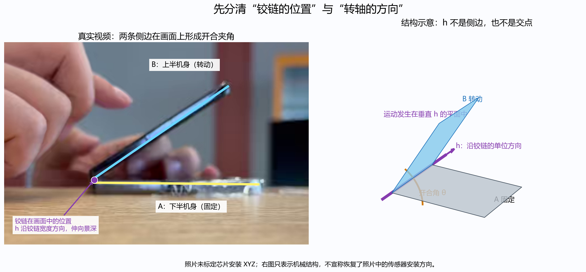
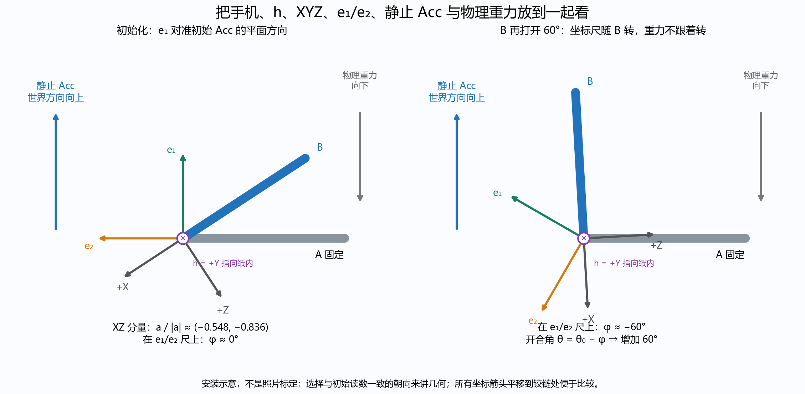
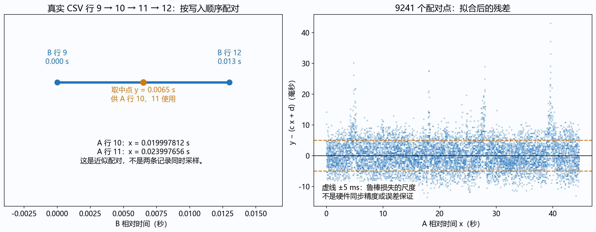
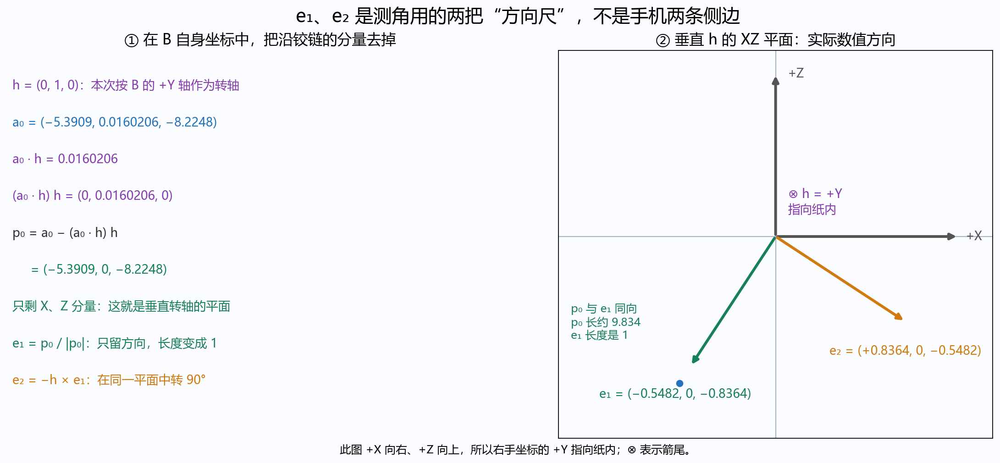
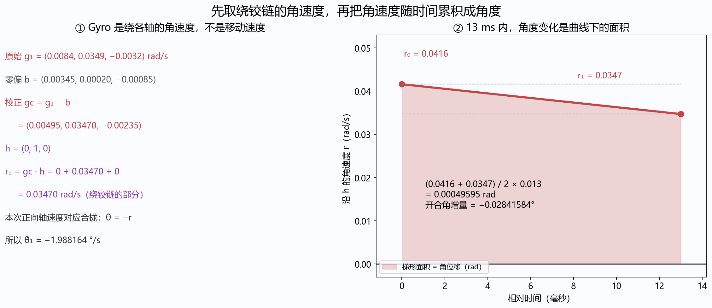
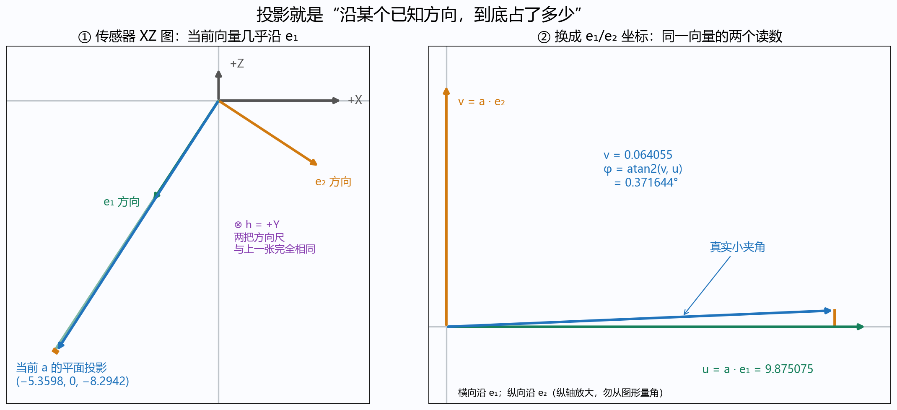
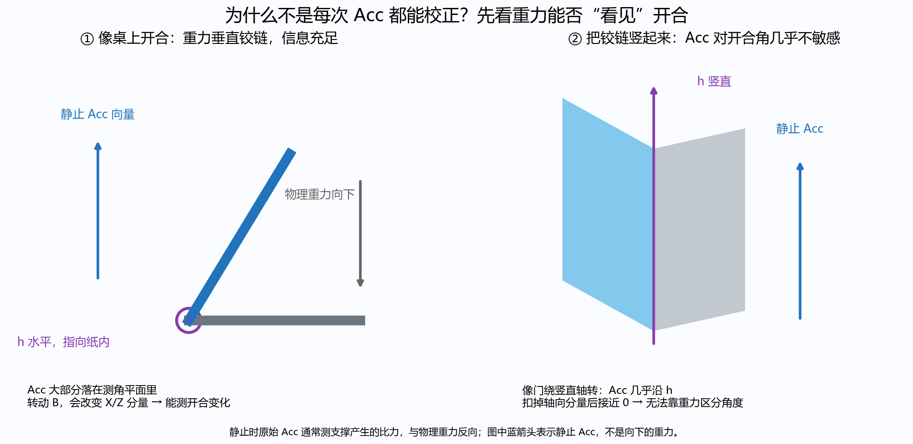

# 手机铰链轴与 IMU 角度计算：六个问题逐步图解

本文对应原始数据 `data/raw/sensor_log_2026-10-16_11-04-53.csv`，解释已经运行的固定底座估计器。主 A 固定，副 B 随上半机身转动；闭合 0°，展开 180°。这里的结果是物理公式和互补校正的计算，没有训练神经网络，也没有运行卡尔曼滤波。

之前的说明省略了坐标朝向、向量的物理含义和拟合细节。这些不是可以省略的前提。本文先画清手机与转轴，再回答时间拟合和每个计算步骤。建议按本文顺序读；各部分标出了对应你的问题编号。

**数字来源和图片含义：** 原始 CSV、现有 `imu_angle.py`、`analyze_imu_log.py` 和 `analyze_synchronized_experiment.py`。实际视频截图只标注可见机身与铰链位置；带 XYZ 的手机图是说明坐标关系的安装示意，并非从照片精确恢复的芯片安装姿态。XZ 坐标图中的数值方向则严格按当前程序的坐标定义绘制。

## 一、先看手机：h 到底是什么（问题 6 的前提）



左边是本次视频的真实截图。黄色长侧边属于固定的 A，蓝色长侧边属于转动的 B。它们在画面中形成开合角。紫色圆点是铰链在这一侧视图中的位置。

但手机不是两根二维棍子。手机有宽度，铰链也是横跨机身宽度的一整条转轴。右边结构图里的紫色线就是这条轴。上半机身绕它转动。

**h 表示沿这条转轴的单位方向，在副 IMU B 自己的 XYZ 坐标中表达。**

必须区分三个东西：

| 量 | 物理含义 | 用途 |
|---|---|---|
| 铰链点 O | 轴线上的某个位置，有长度单位 | 视觉中固定两条射线的共同起点 |
| 转轴方向 h | 轴线沿哪个方向，长度归一为 1，无量纲 | 选取绕铰链的角速度、定义测角平面 |
| 两条侧边方向 | 从铰链指向各自自由端 | 视觉中直接计算开合夹角 |

**h 不是手机侧边、不是重力、不是一个角，也不是画面中的紫色交点。** 在理想刚性安装中，把 IMU 移到同一半机身另一位置，不改变 h 在它坐标中的方向；安装朝向变了，则 h 的坐标会变。

### 1.1 为什么本次 h = (0,1,0)

这句话的意思是：本次用 B 的 +Y 轴近似铰链的正向，X/Z 轴组成垂直铰链的测角平面。

在本次同步实验里，这个选择有数据依据，具体执行过程是：

1. 读取 B 的原始 Acc 记录，按时间计算相邻向量变化率。
2. 保留模长在 9.2～10.4 m/s²、相邻变化率小于 15 m/s³ 的向量，尽量排除强烈动态扰动。
3. 每列减去其中位数，构成 N×3 矩阵 M。
4. 用奇异值分解拟合这些 Acc 点所在的平面，取最小奇异值对应的右奇异向量作为法向。

其数学形式是寻找长度为 1 的向量 n，使：

$$\min_{\|n\|=1}\|Mn\|^2.$$

如果手机主要绕一条固定轴转，重力在 B 坐标中的向量会绕这条轴变化，这些向量端点近似落在一个平面上；该平面的法向就提供铰链方向线索。

本次得到：

$$n=(0.0023750,\ 0.9999955,\ -0.0018363).$$

Y 分量接近 1，X/Z 接近 0。因此现有代码取最大分量对应的坐标轴，简化为：

$$h=(0,1,0),\qquad\|h\|=1.$$

再用 B 的运动 Gyro 做独立核对，其主要变化方向约为：

$$n_{gyro}=(0.0020465,\ 0.9999645,\ -0.0081678),$$

也接近 +Y。注意：**这次使用了整段离线数据来找轴；不是每收到一条新数据就重新找轴。** 新设备、重新安装、轴不接近坐标轴时，需要重新标定，并应保留完整的三维单位轴，而不是永远写死 `(0,1,0)`。

轴线本身没有天然正负。程序把主分量选成正向，并通过动作核对使用“正轴速度对应合拢”的约定。因此本次开合角速度是 `−r`。把 h 反向时，相关符号也必须一致调整。

### 1.2 XYZ、重力与 e1/e2 到底跟着谁动



这张图选择一种与初始读数相容的示意安装朝向，所有箭头平移到铰链处，以便比较方向。它不是对照片中芯片安装的测量。

读图时注意：

* 灰色 A 固定；蓝色 B 绕紫色 h 打开。
* B 上的 XYZ 坐标方向随 B 一起转。它们不是桌子的坐标。
* e1/e2 是在 B 坐标中确定的两根参考方向，初始化后其坐标数值固定，因此在现实空间中也随 B 转。
* 物理重力始终朝下，不随 B 转。
* 静止加速度计通常测的是支撑产生的比力，约与物理重力反向。图中向上的蓝箭头是静止 Acc 的世界方向，不是向下的物理重力。

**为什么 Acc 分量会变？因为手机上的坐标尺转了，而世界中的静止参考方向没跟着转。** 类似一根始终竖直的箭头，用一把旋转的直角尺去量，它沿两条尺子的读数会变。

图中 B 再打开 60° 后，e1/e2 随它转了 60°，但向上的静止 Acc 没转。因此 Acc 相对于这两根尺子的相位约改变 −60°；本次的开合角公式 `θ = θ0 − φ` 会给出开合角增加 60°。

## 二、主 A 的时间为什么另算，两个系数怎样得到（问题 1）

### 2.1 原始 CSV 中确实有两种时间基准

主 A 的记录使用约 `54192337235780` 这样的时间戳，副 B 的记录使用约 `1792119894952000000` 这样的时间戳。不能直接相减或按数值大小跨传感器排序，就认为得到同一个物理时刻。

本次以 B 时间为共同参考，先分别减去各自的起点：

$$T_{A0}=54192337235780\ \mathrm{ns},$$
$$T_{B0}=1792119894952000000\ \mathrm{ns}.$$

对每一条 A 记录定义：

$$x_i=\frac{T_{Ai}-T_{A0}}{10^9}\quad(\mathrm{s}).$$

目标是找到一条直线，把 A 的相对秒数换成近似 B 相对秒数：

$$\widehat t_B=cx_i+d.$$

c 表示时间尺度，d 表示相对原点偏移。这里用 c/d 避免与 Acc 向量 a 混淆。B 的时间直接用 `(timestamp_ns−TB0)/1e9`，不需要这次 A→B 转换。B 时间戳也不因此就成了绝对精确真值。

### 2.2 先从 CSV 行顺序构造近似配对点

原文件第 1 行是表头。下面的行号是包含表头的文件行号：

| CSV 行 | sensor | timestamp_ns |
|---|---|---:|
| 9 | gyro1（B） | 1792119894952000000 |
| 10 | 加速度传感器（A） | 54192357233592 |
| 11 | 陀螺仪传感器（A） | 54192361233436 |
| 12 | acc1（B） | 1792119894965000000 |

对 A 的第 10 行，沿**文件写入顺序**向前找到最近 B 记录（第 9 行），向后找到最近 B 记录（第 12 行）。注意不是寻找时间数值最接近的记录，因为两个时钟尚未对齐。

两条 B 记录的相对时间分别是：

$$t_B^-=0,\qquad t_B^+=0.013\ \mathrm{s}.$$

取中点作为这个 A 记录的近似对应 B 时间：

$$y_i=\frac{t_B^-+t_B^+}{2}=0.0065\ \mathrm{s}.$$

记录前后跨度：

$$w_i=t_B^+-t_B^-=0.013\ \mathrm{s}.$$

同时计算这条 A 记录的自身相对时间：

$$x_i=\frac{54192357233592-54192337235780}{10^9}=0.019997812\ \mathrm{s}.$$

于是得到一个拟合点：

$$\boxed{(x_i,y_i)=(0.019997812,\ 0.0065)}.$$

第 11 行也夹在这两条 B 记录之间，所以得到同一个 y，但 x 不同。**这恰好说明：每个配对点本来就只是近似，不能当作严格同时采样。**



一些真实配对点如下：

| A 所在 CSV 行 | x：A 相对时间/s | 前后 B 时间/s | 中点 y/s | 跨度/ms |
|---|---:|---|---:|---:|
| 10 | 0.019997812 | 0.000，0.013 | 0.0065 | 13 |
| 11 | 0.023997656 | 0.000，0.013 | 0.0065 | 13 |
| 14 | 0.029996719 | 0.013，0.028 | 0.0205 | 15 |
| 15 | 0.033996562 | 0.013，0.028 | 0.0205 | 15 |

当前实现先取原始行顺序构造配对，没有先去重。共有 9,417 条 A 记录，即 9,417 个近似点；只取 `w < 0.025 s` 的 9,241 个点拟合，排除 176 个跨度较大的点。

**边界细节也必须交代：** 开头 4 条 A 记录之前没有 B 记录。现有代码把前后 B 都取成第一条 B，产生 y=0、w=0，它们仍被纳入拟合。这不是有效的双侧夹取，只是现有实现的边界处理。本次另做了排除这 4 条记录的诊断，d 约变化 −0.00930 ms；没有据此改写既有实验结果。

### 2.3 再用所有合格点同时拟合 c 和 d

定义拟合残差：

$$r_i=cx_i+d-y_i.$$

普通最小二乘会最小化 `Σri²`，大异常点的影响会很大。当前代码使用 SciPy 的 `least_squares`，参数是：

```python
fit = least_squares(
    lambda z: z[0] * x[selected] + z[1] - y[selected],
    [1.0, 0.0],
    loss='soft_l1',
    f_scale=0.005,
)
c, d = fit.x
```

这里 `[1,0]` 是求解起点，不是最终系数。`f_scale=0.005` 的单位是秒，即 5 ms。

实际最小化的目标可写为：

$$\boxed{J(c,d)=\sum_i C^2\left(\sqrt{1+(r_i/C)^2}-1\right),\quad C=0.005\ \mathrm{s}.}$$

当 `|ri|` 很小时，它近似 `ri²/2`；当 `|ri|` 很大时，它近似随 `|ri|` 线性增长。大异常点仍参与拟合，但影响受到抑制。这就是这里“鲁棒”的具体含义。

如果想进一步看清系数如何求出，可把其最优条件理解成不断更新权重的加权直线拟合：

$$\omega_i=\frac{1}{\sqrt{1+(r_i/C)^2}}.$$

例如 1 ms 残差对应权重约 0.981，20 ms 残差约 0.243。给定权重时，c/d 满足：

$$
\begin{bmatrix}
\sum\omega_i x_i^2 & \sum\omega_i x_i\\
\sum\omega_i x_i & \sum\omega_i
\end{bmatrix}
\begin{bmatrix}c\\d\end{bmatrix}
=
\begin{bmatrix}\sum\omega_i x_i y_i\\\sum\omega_i y_i\end{bmatrix}.
$$

权重又依赖残差，残差又依赖 c/d，所以要数值迭代。上式用于解释目标函数的最优条件；实际代码调用 SciPy 优化器，并没有手写这一套迭代。

重新读取原 CSV，按相同规则重新计算得到：

$$\boxed{c=1.0000133693743427,\quad d=-0.014183239063981336\ \mathrm{s}.}$$

因此实际换算公式是：

$$\boxed{t_A^{\mathrm{mapped}}=1.0000133693743427\frac{T_A-54192337235780}{10^9}-0.014183239063981336.}$$

例：第 10 行 x=0.019997812 s，换算后：

$$\widehat t_B=0.0058148402942533\ \mathrm{s}.$$

与为它分配的中点 0.0065 s 相差 0.685160 ms。直线不会穿过所有近似点，而是让整体鲁棒目标最小。

c−1 约 13.369 ppm，只能解释为这套软件配对得到的表观比例差；d 约 −14.183 ms 是相对原点偏移，不能直接叫作硬件传输延迟。记录顺序受缓存、调度、批量写入影响，所以二者都不应该直接复用到下一次录制。

已有报告给出的全体配对残差 P5/P50/P95 约 −7.237/−0.078/7.897 ms，是相对于这些近似中点的离散程度，**不是硬件同步误差的置信区间**。软件无法仅凭这种日志证明真实同步误差的上限。

## 三、为什么要建立 e1/e2（问题 2）

### 3.1 先把“用重力测转角”的几何关系画出来

沿着铰链方向看，上半机身的开合近似是在一个二维平面内转动。我们需要在这个平面中建立一套角度刻度：

* 初始 Acc 的平面方向当作 0° 参考，这根单位箭头叫 e1。
* 在同一平面中与它垂直的一根单位箭头叫 e2。
* 之后的 Acc 沿 e1 有多少、沿 e2 有多少，决定它相对于初始参考的角度。

这类似在纸上画横轴和纵轴，只不过横轴选成了初始 Acc 方向，而不是原来的 X 轴。



右图是**B 自己的 XZ 坐标图**：+X 向右，+Z 向上。为了满足右手 XYZ，+Y 必须指向纸内，图中用圈内叉号表示。不是说世界中的 X 必然水平；这只是把传感器的坐标平面正对读者展示。

### 3.2 a0 为什么用中位数

把 Acc B 对齐到 Gyro B 的采样时刻，在开始 1 s 的初始化窗口中有 96 个 Acc 向量。对 X、Y、Z 各自取中位数：

$$a_0=(-5.3909,\ 0.0160205837,\ -8.2248)\ \mathrm{m/s^2}.$$

中位数用于降低少量异常样本的影响。它不是逐帧低通滤波，也不保证窗口完全静止；这里依赖初始化窗口近似静止的实验假设。对各分量分别取中位数，得到的组合向量也不一定是某一条真实采样。

其模长：

$$g_{ref}=\|a_0\|=\sqrt{a_{0x}^2+a_{0y}^2+a_{0z}^2}=9.834093477\ \mathrm{m/s^2}.$$

这个量记录本次初始化时 Acc 模长的参考值，用于后面的质量筛选。

### 3.3 为什么先减去 (a0·h)h

一个向量可以拆成沿 h 的部分和垂直 h 的部分：

$$a_0=a_{\parallel}+a_{\perp}.$$

如果 h 长度是 1，那么点积 `a0·h` 就是沿轴的带符号分量；再乘 h，得到对应的三维向量：

$$a_{\parallel}=(a_0\cdot h)h.$$

所以：

$$p_0=a_{\perp}=a_0-(a_0\cdot h)h.$$

代入本次 h：

$$a_0\cdot h=(-5.3909)\times0+0.0160205837\times1+(-8.2248)\times0=0.0160205837.$$

$$a_{\parallel}=(0,0.0160205837,0).$$

$$\boxed{p_0=(-5.3909,0,-8.2248).}$$

**这里就是把 Y 分量去掉，只保留 XZ 平面中的箭头。** 因为我们要量的是绕 Y 轴的转动，沿 Y 的那一部分不提供平面内指向。

对任意倾斜轴，不能直接把某个分量清零；`a−(a·h)h` 才是一般形式。

### 3.4 归一化是只保留方向

$$\|p_0\|=9.834080427\ \mathrm{m/s^2}.$$

$$\boxed{e_1=\frac{p_0}{\|p_0\|}=(-0.548185470,0,-0.836356796).}$$

归一化相当于把原来长度约 9.834 的箭头缩成长度 1，朝向不变。因此 e1 没有加速度单位。它的方向在 XZ 图中是左下方。

注意 `|p0|` 与 `gref=|a0|` 略有差别，因为 p0 去掉了 Y。两者在本次几乎相等，但公式不能混写。

### 3.5 e2 的叉乘怎样算，负号怎么理解

叉乘 `u×v` 给出同时垂直 u 和 v 的方向。h 垂直测角平面，e1 在平面内，因此 `h×e1` 也在这个平面内，并且与 e1 垂直。

对于 `h=(0,1,0)`、`e1=(x,0,z)`，可以直接算：

$$h\times e_1=(z,0,-x).$$

本次程序取其反向：

$$e_2=-h\times e_1=(-z,0,x).$$

所以：

$$\boxed{e_2=(0.836356796,0,-0.548185470).}$$

XZ 图里它指向右下方。e1/e2 长度都为 1，点积为 0，因此是两根相互垂直的方向尺。

**负号是一整套角度正负约定的一部分，不是叉乘必须带负号。** 当前 `e1×e2=−h`，不能把 `(e1,e2,h)` 叫作右手坐标系。本次的 `e2=−h×e1`、`θ=θ0−φ` 和 `θ̇=−r` 相互配套；不能随便只改其中一个符号。

## 四、r1 = gc·h 为什么是 0.0347（问题 3）



### 4.1 Gyro 三个数分别表示绕哪根轴转得多快

当前 B 的 Gyro 原始数据：

$$g_1=(0.0084,0.0349,-0.0032)\ \mathrm{rad/s}.$$

例如正 Y 分量表示按绕 +Y 的右手正向转动的角速度。它不是“沿 Y 方向移动”的速度。

先扣除从初始窗口估计的零偏：

$$b=(0.00345,0.00020,-0.00085)\ \mathrm{rad/s}.$$

$$g_c=g_1-b=(0.00495,0.03470,-0.00235)\ \mathrm{rad/s}.$$

### 4.2 点积提取绕铰链的那部分

单位向量的点积等于沿该方向的带符号投影：

$$r_1=g_c\cdot h=\|g_c\|\cos\alpha,$$

其中 α 是角速度向量与轴方向的夹角。本次：

$$r_1=0.00495\times0+0.03470\times1+(-0.00235)\times0.$$

$$\boxed{r_1=0.03470\ \mathrm{rad/s}.}$$

所以它不是另一个复杂算法得到的新数字，就是**扣零偏后的 Y 轴角速度**。只有因为本次 h 恰好是单位 Y，才可以这样直接取 Y；一般情况下必须把 XYZ 三项一起投影。

### 4.3 正轴速度不等于开合角增加

本次选的 +h 方向下，正 r 对应手机合拢，而开合角定义是合拢时减小。因此：

$$\dot\theta=-r.$$

$$\dot\theta_1=-0.0347\times\frac{180}{\pi}=-1.988163549\ ^\circ/\mathrm{s}.$$

这里 r 是绕轴转动速度，θ 是机械开合角，要靠统一的符号约定连接二者。

此外，**该固定底座分支默认 A 不转动。** 如果整机也在手中转，只投影 Gyro B 会混入整机运动；不能把这个分支直接当作任意手持算法。双 IMU 分支会在各自已对齐的轴和时间上做轴向速度差，但安装坐标、符号、同步和任意运动的验证仍需要完成。

## 五、梯形积分究竟在做什么（问题 4）

### 5.1 从“速度乘时间”理解

如果角速度恒定为 10°/s，持续 0.1 s，角度就变化 1°。如果速度随时间变化，则要把很短时段内的“速度×时间”加起来：

$$\Delta\theta=\int\dot\theta(t)\,dt.$$

积分的图形含义就是角速度曲线与时间轴之间的带符号面积。上图右边红色区域代表沿轴角位移，按本次约定取负号后成为开合角增量。

### 5.2 为什么不是只取当前一条速度乘 dt

两次 Gyro 时间为：

$$t_0=0,\quad t_1=0.013\ \mathrm{s},\quad\Delta t=0.013\ \mathrm{s}.$$

两端轴向速度分别是：

$$r_0=0.0416,\quad r_1=0.0347\ \mathrm{rad/s}.$$

两次采样之间速度怎么变，传感器没有给出完整曲线。当前代码做一个近似：**用一条直线连接两端速度。** 于是曲线下方就是一个梯形，其面积等于“两条平行边平均值×间距”：

$$\int_{t_0}^{t_1}r(t)dt\approx\frac{r_0+r_1}{2}(t_1-t_0).$$

如果需要从公式推导，令区间内速度线性变化：

$$r(t)=r_0+\frac{r_1-r_0}{\Delta t}(t-t_0).$$

积分得到：

$$r_0\Delta t+\frac{r_1-r_0}{\Delta t}\frac{\Delta t^2}{2}=\frac{r_0+r_1}{2}\Delta t.$$

这就是梯形积分。对真正线性变化的速度它是精确的；对未知真实运动只是一种数值近似，并没有恢复采样间没有观测到的细节。

### 5.3 代入这一段原始数据

$$\bar r=\frac{0.0416+0.0347}{2}=0.03815\ \mathrm{rad/s}.$$

$$\Delta\theta=-0.03815\times0.013=-0.00049595\ \mathrm{rad}.$$

rad 转成角度乘 `180/π`：

$$\boxed{\Delta\theta=-0.02841584185^\circ.}$$

与两种矩形近似对照：

| 区间速度近似 | 沿轴角位移/rad |
|---|---:|
| 全程用前一速度 0.0416 | 0.00054080 |
| 全程用当前速度 0.0347 | 0.00045110 |
| 两端线性连接，取梯形 | 0.00049595 |

初始角是本次从视频参考获得的 33.253755°，因此仅靠 Gyro 预测：

$$\theta_1^-=33.253755-0.02841584185=33.22533915815^\circ.$$

符号 `−` 上标表示“还没被当前 Acc 校正的预测值”，不是负角度。

后续每条数据都这样算，但从**上一次融合结果**往前推：

$$\theta_k^-=\theta_{k-1}-\frac{r_{k-1}+r_k}{2}\Delta t_k\frac{180}{\pi}.$$

纯 Gyro 曲线则从上一次纯 Gyro 结果累加，两者要分清。dt 来自整数时间戳之差，而不是直接信任 `delta_ms`。持续零偏会被积分成漂移，梯形法本身不能消除零偏。

## 六、当前 Acc 究竟投影到哪两个方向（问题 5）

就是第三部分已经建立的两根方向尺，**不是重新选方向，也不是分别投到上下两半手机的侧边**：

$$e_1=(-0.548185470,0,-0.836356796),$$
$$e_2=(0.836356796,0,-0.548185470).$$

当前原始 Acc B 为：

$$a=(-5.3598,0.0095,-8.2942)\ \mathrm{m/s^2}.$$



左图仍采用 B 的 XZ 坐标：绿箭头是 e1，橙箭头是 e2，蓝箭头是当前 a 在 XZ 中的部分。蓝箭头几乎沿绿箭头，但有一点偏向橙箭头。

右图把同一向量换到 e1/e2 坐标下画：横轴沿 e1，纵轴沿 e2。为了看清非常小的纵向读数，纵轴放大；不能直接从图形外观量角。

### 6.1 投影就是点积，逐项算出来

沿 e1 的有符号分量：

$$u=a\cdot e_1$$

$$=(-5.3598)(-0.548185470)+0.0095\times0+(-8.2942)(-0.836356796)$$

$$\boxed{u=9.8750750208\ \mathrm{m/s^2}.}$$

沿 e2 的有符号分量：

$$v=a\cdot e_2$$

$$=(-5.3598)(0.836356796)+0.0095\times0+(-8.2942)(-0.548185470)$$

$$\boxed{v=0.0640547680\ \mathrm{m/s^2}.}$$

因为 e1/e2 与 h 垂直，先去掉 a 的轴向部分再投影，或直接做上面两个点积，结果一样：

$$a_\perp=a-(a\cdot h)h=u e_1+v e_2.$$

三维向量完整分解为：

$$a=u e_1+v e_2+(a\cdot h)h.$$

### 6.2 为什么 atan2(v,u) 就是转角

在一套垂直单位坐标轴里，如果平面向量长度为 L，与横轴 e1 的角度为 φ，那么：

$$u=L\cos\phi,\qquad v=L\sin\phi.$$

所以从两个读数反求：

$$\phi=\operatorname{atan2}(v,u).$$

使用 atan2 而不是简单 `atan(v/u)`，是为了保留两个分量的正负，正确区分象限，也避免 u=0 时直接除零。

本次：

$$\phi=\operatorname{atan2}(0.0640547680,9.8750750208)$$
$$=0.006486418533\ \mathrm{rad}=0.3716444061^\circ.$$

这个 0.371644° 是**相对于初始化参考方向的 Acc 相位**，不是当前手机开合角；e1 相对 X 的角度也不是手机开合角。

最后用已知初始角连接到机械角定义：

$$\theta_{acc}=\theta_0-\phi\frac{180}{\pi}$$

$$\boxed{\theta_{acc}=33.253755-0.3716444061=32.8821105939^\circ.}$$

**初始开合角 θ0 是必要的外部参考。** 此处不是凭单条 B Acc 就无条件求出了两半手机的绝对夹角。代码还会以 Gyro 预测为参考选择相位对应的 360° 分支，以处理 atan2 的环绕；本例没有跨 ±180°，不用加减整圈。

## 七、为什么要判断 Acc 角能不能参加校正（问题 6）

### 7.1 Acc 测到的不总是静止重力参考

加速度计测量的是比力。概念上，在 B 坐标中：

$$a_{meas}\approx R_{BW}(a_{linear}^{W}-g^W)+b_a+n_a.$$

其中 R 把世界坐标向量换到 B 坐标，`a_linear` 是传感器位置的实际运动加速度，g 是向下的重力，`b_a` 是偏置，`n_a` 是噪声。固定转轴开合时，传感器离轴还有距离，也可能受到切向和向心加速度。

静止时 `a_linear≈0`，读数约是反向重力的坐标表达；快速晃动、敲击、急加减速时，用它当作纯重力方向可能算错角度。

所以先由 Gyro 预测，然后检查当前 Acc 是否适合缓慢纠偏。这里的“门控”就是若干 `if` 条件，不是神经网络置信度。

### 7.2 五道判断，各自检查什么

| 判断 | 当前代码条件 | 直观含义 |
|---|---|---|
| 模长 | `abs(|a|−gref) < 0.6 m/s²` | 读数大小不要偏离初始化静止模长太远 |
| 投影可观测性 | `|a−(a·h)h|/gref > 0.2` | 在垂直铰链的平面中必须剩下足够长的箭头 |
| 相邻变化率 jerk | `|ak−ak−1|/dt < 30 m/s³` | 相邻向量不能变化得太突然 |
| 低转动 | `|gyro−bias| < 0.25 rad/s` | 本次只在转动较慢时让 Acc 校正 |
| 预测一致性 | `abs(θacc−θpred) < 20°` | Acc 观测不能与当前预测严重冲突 |

另要求相位是有限值。双侧分支对 A 的 Acc 质量和 Gyro 低运动也有相应条件；本表解释的是正在逐条演算的固定底座 B 分支。

这些阈值是当前程序的工程设置，不是证明出来的自然常数，也不是自动训练得到的参数。全部通过也不保证 Acc 完全没有动态误差。

### 7.3 最难理解的一道：为什么需要垂直 h 的投影



左图像当前桌面实验：铰链近似水平，静止 Acc 的方向主要垂直铰链，因此在测角平面内有一根很长的向量。B 转动时，它的 X/Z 读数会变化，可以估计转角。

右图把铰链竖起来，类似开门：上下重力方向几乎沿着转轴。绕竖直轴开到不同角度，重力沿轴这一事实不变，静止 Acc 读数基本不变。

极端情况：

$$a\approx g_{ref}h,$$

则：

$$a_\perp=a-(a\cdot h)h\approx0.$$

此时 e1/e2 上的两个分量都接近 0，微小噪声就能让算出的相位大幅摆动；当两者都为 0 时，方向在物理上没有定义，不能信软件返回的某个数。

因此比值：

$$q=\frac{\|a_\perp\|}{g_{ref}}$$

是在检查测角平面里的参考向量够不够长。理想静止时，如果 Acc 与 h 夹角为 β，那么 `q≈|sinβ|`：平行时 q≈0，垂直时 q≈1。

当前样本 q=1.004188 略大于 1，不矛盾，因为分母是**初始化的固定 gref**，不是当前的 `|a|`。实际读数含噪声或运动，当前模长可能比初始化稍大。

**这条几何限制不会因为换成卡尔曼滤波或深度学习就消失。** 学习方法可以利用历史、运动约束和额外信息，但纯静止、铰链与重力平行时，两个 Acc 本身不能唯一告诉你绕这条轴转了多少。

### 7.4 逐项代入当前样本

当前 `t=0.013 s`，由前述计算得到：

| 判断 | 实际数值 | 结果 |
|---|---|---|
| 模长偏差 | `|9.875287334−9.834093477| = 0.041193857 < 0.6` | 通过 |
| 平面分量比 | `1.004188417 > 0.2` | 通过 |
| jerk | `6.433809550 < 30 m/s³` | 通过 |
| 校正 Gyro 模长 | `0.035129973 < 0.25 rad/s` | 通过 |
| Acc 与预测差 | `|32.882110594−33.225339158| = 0.343228564 < 20°` | 通过 |

jerk 也可以用原始相邻 Acc 手算：

$$a_{prev}=(-5.3981,0.0143,-8.2200),$$

$$a-a_{prev}=(0.0383,-0.0048,-0.0742),$$

$$j=\frac{\sqrt{0.0383^2+(-0.0048)^2+(-0.0742)^2}}{0.013}=6.433809550\ \mathrm{m/s^3}.$$

这里的差分同时包含方向旋转和实际动态扰动，并非严格分离后的平移加速度导数；当前代码把它作为读数变化率指标。

Gyro 模长判断看的是整个 XYZ 向量，不是只看 r。`0.25 rad/s≈14.324°/s`。**超过它只会停用当前 Acc 校正，不会停掉快速开合时的 Gyro 积分。** 例如本次 t=2.003 s 时校正 Gyro 模长约 0.4244 rad/s，程序保留预测角约 36.2770°，不拿当时 Acc 约 35.0485°去拉它。

模长接近 g 并不能证明没有运动；缓慢平移、偏置等可能同时通过多道门控。相反，若 Gyro 长期漂移到与真实观测相差超过 20°，最后一道门也可能拒绝本来有效的校正。这些都是现有启发式规则的局限。

### 7.5 通过后怎么校正，为什么不直接替换为 Acc 角

通过不代表完全相信。当前实现用时间常数 τ=1 s 的互补校正：

$$K=1-e^{-\Delta t/\tau}.$$

dt=0.013 s 时：

$$K=1-e^{-0.013}=0.01291586498.$$

创新量（观测与预测的差）：

$$\varepsilon=\theta_{acc}-\theta^-=-0.34322856426^\circ.$$

只采纳其中约 1.29%：

$$\theta=\theta^-+K\varepsilon.$$

$$\theta=33.22533915815+0.01291586498\times(-0.34322856426).$$

$$\boxed{\theta=33.22090606436^\circ.}$$

这一次 Acc 实际只把角度下拉 0.004433094°。若不通过，则本条直接输出 Gyro 预测：`θ=θ−`。τ 越大校正越慢，τ 越小校正越强；现有 K 由固定公式决定，不是卡尔曼增益，没有协方差自适应更新。

长间断属于另一类情况：代码对超过 0.1 s 的 Gyro 间隔不盲目跨越积分，先使状态失效，后续在合格 Acc 观测和低运动时尝试重建角度。当前真实演算的连续样本没有触发这一分支。

## 八、把这一条数据从原始 CSV 一直串到输出

```text
原始 CSV 第 13 行 gyro1
g = (0.0084, 0.0349, -0.0032) rad/s
             ↓ 扣去初始静止窗口零偏
gc = (0.00495, 0.03470, -0.00235)
             ↓ 点乘 h=(0,1,0)，取绕铰链分量
r = 0.03470 rad/s
             ↓ 与上一条 r=0.04160 做梯形积分，dt=0.013 s
开合角增量 = -0.02841584185°
             ↓ 加到上次融合角 33.253755°
Gyro 预测 θ− = 33.22533915815°

原始 CSV 第 12 行 acc1
a = (-5.3598, 0.0095, -8.2942) m/s²
             ↓ 点乘初始化确定的 e1、e2
u = 9.8750750208；v = 0.0640547680
             ↓ atan2(v,u)
φ = 0.3716444061°
             ↓ θ0−φ
Acc 角 = 32.8821105939°
             ↓ 五道门控，本条均通过
创新量 = -0.34322856426°，K = 0.01291586498
             ↓ θ = θ− + K × 创新量
本条最终输出 = 33.22090606436°
```

这两条 B 数据时间戳相同，正好不需要为此样本插值；其他时刻 Acc/Gyro 不同时间时，现有离线流程会按各轴线性插值对齐，禁止跨过较长缺口。线性插值可能用到目标时刻之后的 Acc，不能把整套离线预处理直接声称为零延迟在线流程。

下一条数据保留并使用上一次融合角、上一次轴向速度、上一次时间和 Acc；继续重复同样的更新。零偏、轴 h、e1/e2、gref 和 θ0 属于初始化参数，正常更新时不逐条重新拟合。

在这个固定底座 B 分支中，刚才演算的 B 时间间隔和 B Acc/Gyro 本身并不需要 A→B 拟合；主 A 的时钟映射服务于主副数据对齐、双侧分支和实验对照。不要把“主 A 时间映射”误认为刚才这条 B 积分所需的另一个滤波步骤。

## 九、本次补充说明可以核对什么

本次新增图解与核查没有重写原 CSV，没有修改既有估计器或覆盖之前的实验结果。

* [图解生成和时间拟合复算脚本](../outputs/explanation_20261018/build_explanation.py)
* [9,417 条逐行时间配对表](../outputs/explanation_20261018/clock_pairs.csv)
* [拟合系数、真实行号样例和边界诊断](../outputs/explanation_20261018/clock_fit_details.json)
* [本次说明的数值核查结果](../outputs/explanation_20261018/verification.json)
* [上一份逐条计算教程](从原始CSV到下一条IMU数据_完整计算教程.md)
* [4,085 条完整更新中间量](../outputs/experiment_20261016_110453/csv_to_angle_trace.csv)

复算确认本次拟合 c/d 与既有 `infer_clock_map` 输出一致；参考方向长度为 1、相互垂直，`e1×e2=−h`；当前 Acc 能由三个正交分量重构，atan2 相位与已有逐条记录一致；7 张图均可解码。上述检查验证的是解释与代码一致，不是对真实机械角度精度的独立验证。
