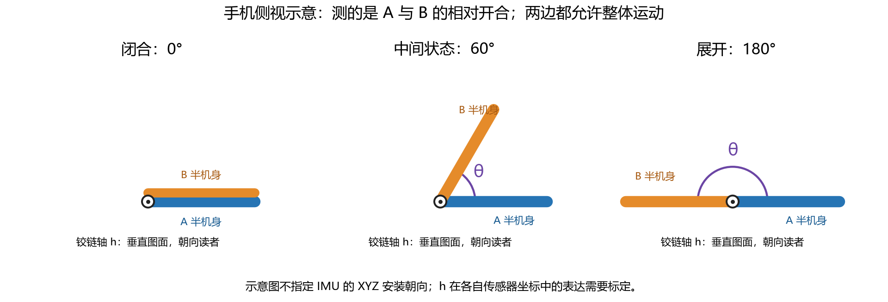
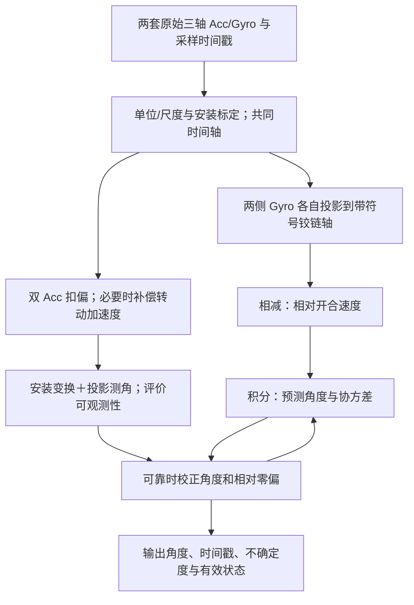

# 通用双 IMU 开合角：从机械结构到实时估计

本文回答：手机任意手持、两半机身都运动时，怎样通过两套 Acc＋Gyro 计算开合角？

**主线只有一句：两个 Gyro 测两半机身绕同一根铰链的转速，相减得到开合速度；积分得到角度变化；两个 Acc 在可靠时提供角度参考，滤波器融合二者并估计漂移。**

下面的通用数学模型是方法说明，不代表当前代码已经实现安装标定、运动加速度补偿或卡尔曼滤波。当前代码的边界见最后一节。

## 1. 先确定我们要估计什么

- A：主半机身，使用自身 IMU 坐标系。A 可以任意运动，不再假设固定。
- B：副半机身，也使用自身 IMU 坐标系。
- W：世界坐标系，只为推导定义，最终估计开合角不一定需要知道它。
- θ：机械开合角。闭合 0 rad，展开 π rad，显示时乘 180/π 转为度。
- h_A、h_B：同一根物理铰链的单位方向，分别用 A、B 的 IMU 坐标表达。

铰链轴是沿铰链长度方向的一根轴，不是手机表面法向，也不是向下的重力方向。沿铰链指向哪一端作为正方向，需要统一约定。

两半机身通过单自由度转动铰链连接。结构理想化为刚体，忽略铰链间隙、弯曲和 IMU 安装松动。

图中 A 朝右只是为了统一绘图视角，不表示 A 在世界中固定。整幅图随手一起转动，不改变两条边之间的 θ。圆点表示铰链轴指向读者；实际铰链沿轴延伸，侧视图只看到其截面。

定义 R_A、R_B：把各自 IMU 坐标中的向量转换到世界坐标。例如 v_W=R_A v_A。旋转矩阵满足 RᵀR=I、det(R)=1。

两边看见的同一根轴必须满足：

$$R_Ah_A=R_Bh_B=h_W.$$

**h_A 不一定等于 h_B。** 例如 A 的铰链方向可能是 +Y，B 因安装方式不同可能是 −X。不能直接把两个 Gyro 的 Y 数值相减而称为通用方法。

## 2. 机械约束：两个姿态只相差一个开合角

定义相对旋转矩阵：

$$C(\theta)=R_A^TR_B.$$

它把 B 坐标中的向量变成 A 坐标中的向量。定义 C₀ 为**闭合 θ=0 时**的 B→A 安装旋转；它通常不是单位矩阵。

选定带符号的铰链轴，使 θ 增大代表打开，就有：

$$\boxed{C(\theta)=\operatorname{Rot}(h_A,\theta)C_0,\qquad h_B=C_0^Th_A.}$$

这里 Rot(h,θ) 表示绕单位轴 h 旋转 θ。其完整表达是 Rodrigues 公式：

$$\operatorname{Rot}(h,\theta)=I+\sin\theta[h]_\times+(1-\cos\theta)[h]_\times^2.$$

其中叉乘矩阵定义为 [h]×v=h×v，若 h=(h_x,h_y,h_z)，则：

$$[h]_\times=\begin{bmatrix}0&-h_z&h_y\\h_z&0&-h_x\\-h_y&h_x&0\end{bmatrix}.$$

这条约束的含义是：整机在世界里怎么转，R_A、R_B 都会变化；但两者相对关系只能沿铰链改变一个角度。

注意：这里 h 的正号按“打开为正”选择。当前旧代码的副侧 +Y 对应合拢，因此它使用负号积分。两种记号可以等价换算，不能把本文的正号与旧代码 +Y 不加区分地混用。

## 3. Gyro 到开合速度：为什么整体手持转动会抵消

先写 Gyro 的测量模型，i 表示 A 或 B：

$$\omega_i^m=\omega_i+b_{g,i}+n_{g,i}.$$

ωᵐ 是原始三轴读数，ω 是真实角速度，b_g 是缓慢变化的零偏，n_g 是随机噪声；这些量均在该 IMU 自身坐标系表达。单位 rad/s。

刚体铰链的真实角速度满足：

$$\boxed{R_B\omega_B-R_A\omega_A=\dot\theta h_W.}$$

意思是：副侧的世界角速度＝主侧的世界角速度＋绕铰链的相对开合速度。任意手持转动包含在主侧角速度中。

两边点乘 h_W，并利用 h_WᵀR_A=h_Aᵀ、h_WᵀR_B=h_Bᵀ，得到：

$$\boxed{\dot\theta=h_B^T\omega_B-h_A^T\omega_A.}$$

换成可读取的测量值：

$$u_m=h_B^T\omega_B^m-h_A^T\omega_A^m,$$

$$\beta=h_B^Tb_{g,B}-h_A^Tb_{g,A},$$

$$\boxed{\dot\theta=u_m-\beta+\eta_g.}$$

η_g 是相减后等效的角速度噪声，符号可吸收入其定义。β 是真正影响开合角积分的**相对轴向零偏**。

例如，统一轴方向后，主侧沿轴转速为 20°/s，副侧为 50°/s，相对开启速度就是 30°/s。手机仅整体转动时，两边投影相等，相减为零。共同转动在其他方向的分量也不会被误当成开合速度，前提是两个轴表达与时间确实对齐。

**这里不需要先解出两个完整世界姿态。** 铰链轴已知时，直接投影相减即可得到唯一自由度的速度。

对于完整三维相对姿态，也可使用精确运动方程：

$$\dot C=-[\omega_A]_\times C+C[\omega_B]_\times.$$

它与上面的单自由度公式相容；如果分别估计两套三维姿态，应持续加入铰链约束，不能把两套独立姿态滤波的误差简单相减后认为问题已解决。

## 4. 积分：速度怎样变成角度

在共同物理时刻 t_k 计算两边数据，Δt_k=t_k−t_{k−1}。令估计的去偏相对速度为 u_k=u_{m,k}−β̂，则梯形积分是：

$$\boxed{\hat\theta_k^-=\hat\theta_{k-1}^++\frac{u_{k-1}+u_k}{2}\Delta t_k.}$$

上标 − 表示本次校正之前的预测，+ 表示校正后的结果。

例如前后相对速度均为 30°/s，间隔 0.01 s，就增加 0.3°。由原来的 60° 得到 60.3°。

但若 β 误估了 0.01 rad/s，60 s 后会累计约 34.38° 误差。低通可以减小高频噪声，不能消除这个持续的偏差，因此还需要角度参考和零偏估计。

时间轴选 A、B 或统一调度均可。关键是每次相减代表同一物理时刻；统一时钟和采样调度是两个问题。实时可采用带时间戳缓冲的小延迟配对或异步状态更新，不能偷偷读取尚未到达的下一条样本。

## 5. Acc 到角度：先讲低动态时的简化模型

> **白话版（先看这一段）**
>
> 想象两页硬纸板用铰链连在一起，每页上贴一个加速度计。静止时，两个加速度计测到的是**同一个世界比力向量**（静止时就是支撑力方向，和重力相反），只是各自用自己页面的坐标来表达。闭合时，两页的坐标差一个固定的安装旋转 `C0`；打开 θ 后，第二页相对第一页绕铰链转了 θ。所以：先把 B 的读数做 `C0 f_B` 转到 A 的闭合坐标系，再绕铰链转 θ，就得到 A 的读数 `f_A`。
>
> 沿铰链方向的分量绕轴旋转不变，不能告诉你开了多少度，先去掉；剩下**垂直于铰链的平面**里的两个箭头，用 `atan2(叉积, 点积)` 读出它们之间的夹角。
>
> 这个模型只在“手机基本不加速”时成立；如果重力方向接近铰链轴，垂直分量接近零，角度就不可观测。

加速度计测的是比力，不是直接测“重力角”。用 f_i^m 表示 CSV 中的 Acc：

$$\boxed{f_i^m=R_i^T(a_{S_i}^W-g^W)+b_{a,i}+n_{a,i}.}$$

a_{S_i} 是该传感器所在位置的世界线加速度，g 是物理重力加速度。静止时 a_{S_i}=0，因此扣偏后的读数约为 −R_iᵀg。

如果两边位置的运动加速度都很小，令 f_i=f_i^m−b_{a,i}，就有：

$$f_A\approx C(\theta)f_B.$$

这表示两边测到同一根世界参考向量（约为 −g），但用各自坐标表示。

如何直接从这两个三轴向量求机械角？先把 B 读数用**闭合时的安装关系 C₀**换到 A 的基准，再去掉沿铰链的分量：

$$P_h=I-h_Ah_A^T,$$

$$p_B=P_hC_0f_B,\qquad p_A=P_hf_A.$$

P_h 的作用就是保留垂直铰链平面中的分量。沿轴分量绕轴旋转时不改变，不能用来辨认开合角。

因为 p_A=Rot(h_A,θ)p_B，带方向的角度为：

$$\boxed{\theta_{acc}=\operatorname{atan2}\!\left(h_A^T(p_B\times p_A),\ p_B^Tp_A\right).}$$

分母量度“同向程度”，分子量度“绕指定轴朝哪边转”。atan2 同时利用二者，保留角度方向；只有 arccos 容易丢掉方向。

数值例子采用便于观察的坐标，**不是当前 CSV 的实际安装坐标**：

$$h_A=h_B=(0,1,0)^T,\quad C_0=I,$$

$$f_B=(0,0,9.81)^T,\qquad f_A=(8.495709,0,4.905)^T.$$

此时 h_Aᵀ(p_B×p_A)≈83.3429，p_Bᵀp_A=48.11805，atan2 给出 60°。两个输入都有约 9.81 的模长，方向相差 60°。

实际代码应保持角度分支与预测角连续，在 0—π 的机械范围中解释；不能靠硬裁剪掩盖错误标定。

e1/e2 方法是上述平面测角的另一种写法。但如果 e1/e2 只来自任意初始姿态，它测的是相对初始角的变化，需要已知 θ₀。**它不会自动知道闭合是 0°。** 这里 C₀ 提供的正是机械零位参考。

## 6. 任意运动时：Acc 的完整刚体模型

上节的“运动加速度很小”不是通用前提。任意手持、快速开合时，两边 IMU 的运动加速度可能不同，不能直接认为它们都只测重力。

选择铰链上的同一个点 O。设 r_A、r_B 分别为从 O 指向各自 IMU 的位置向量，用各自坐标表示；O 属于铰链轴，理想结构下对两半机身都是固定点。

刚体加速度公式：

$$a_{S_i}^W=a_O^W+R_i\left(\alpha_i\times r_i+\omega_i\times(\omega_i\times r_i)\right).$$

- a_O：整机带着铰链点运动产生的共同线加速度。
- α×r：角速度改变产生的切向加速度。
- ω×(ω×r)：转动产生的向心加速度。

代回测量式：

$$\boxed{f_i^m-b_{a,i}=R_i^T(a_O^W-g^W)+\alpha_i\times r_i+\omega_i\times(\omega_i\times r_i)+n_{a,i}.}$$

如果已知安装位置并能可靠估计 ω、α，可以先扣除转动引起的两项：

$$\widetilde f_i=f_i^m-\hat b_{a,i}-\hat\alpha_i\times r_i-\hat\omega_i\times(\hat\omega_i\times r_i).$$

理想情况下：

$$\widetilde f_i\approx R_i^T(a_O^W-g^W),\qquad\boxed{\widetilde f_A\approx C(\theta)\widetilde f_B.}$$

于是可以把上一节 f_A、f_B 换成补偿后的 f̃_A、f̃_B，再求 θ_acc。这里利用的是共同的“铰链点比力”向量，不要求该向量只包含重力。

这解释了通用模型怎样处理运动，但不等于补偿永远准确：α 需要从去偏 Gyro 随时间变化估计，求导会放大噪声；安装位置、时间对齐、零偏和结构误差也会进入补偿。若使用依赖当前角度的向量残差，实际可构造：

$$r_f=\widetilde f_A-\operatorname{Rot}(h_A,\theta)C_0\widetilde f_B.$$

将 r_f=0 作为 EKF 或优化器的观测关系，按误差来源设置协方差和鲁棒权重。由于补偿与 Gyro 共用数据，严格滤波还需考虑相关噪声；把它当独立白噪声只是工程近似。

## 7. 为什么任意手持也有“暂时无法纠漂”的姿态

当共同参考向量接近铰链方向时：

$$\|P_h\widetilde f_A\|\approx0,\quad\|P_hC_0\widetilde f_B\|\approx0.$$

绕这根轴开合，参考向量几乎不变，Acc 就看不出转了多少。例如铰链竖直且手机近静止时，重力沿铰链，两边 Acc 对开合不敏感。自由落体时共同比力接近零，也无法测角。

此时应依靠双 Gyro 继续预测，并让不确定度随时间增长；恢复可靠参考后再纠漂。**任何滤波器都不能在没有角度信息时凭空制造绝对角度。**

“任意手持实时跟踪”可以以持续预测实现，但“任意姿态无限时间绝对不漂”需要额外观测，例如机械角传感器、霍尔、视觉或可靠的端点事件。

初次启动也是同一问题：Gyro 只能给角度变化。如果启动时参考退化，又没有已知初始角，不能单靠 Gyro 知道当前是 30° 还是 90°。

## 8. 可直接实现的角度＋相对零偏卡尔曼模型

如果已经标定 h_A、h_B、C₀，并能提供带质量评价的 θ_acc，最小状态不必是两套完整三维姿态，而是：

$$x=\begin{bmatrix}\theta\\\beta\end{bmatrix},\qquad\dot\theta=u_m-\beta+\eta_g,\qquad\dot\beta=\eta_\beta.$$

ηβ 表示相对零偏缓慢随机变化。一次采样预测写为：

$$\hat\theta_k^-=\hat\theta_{k-1}^++\left(\frac{u_{m,k-1}+u_{m,k}}2-\hat\beta_{k-1}^+\right)\Delta t,$$

$$\hat\beta_k^-=\hat\beta_{k-1}^+,$$

$$F_k=\begin{bmatrix}1&-\Delta t\\0&1\end{bmatrix},\qquad P_k^-=F_kP_{k-1}^+F_k^T+Q_k.$$

P 是状态误差协方差。若连续时间等效速度噪声强度为 q_g、零偏随机游走强度为 q_β，独立白噪声近似下：

$$Q_k=\begin{bmatrix}q_g\Delta t+q_\beta\Delta t^3/3&-q_\beta\Delta t^2/2\\-q_\beta\Delta t^2/2&q_\beta\Delta t\end{bmatrix}.$$

角度观测模型：

$$z_k=\theta_{acc,k}=Hx_k+v_k,\qquad H=\begin{bmatrix}1&0\end{bmatrix}.$$

匹配角度分支后计算：

$$\nu_k=\operatorname{wrap}_{(-\pi,\pi]}(z_k-\hat\theta_k^-),$$

$$S_k=HP_k^-H^T+\mathcal R_k,\qquad K_k=P_k^-H^TS_k^{-1},$$

$$\hat x_k^+=\hat x_k^-+K_k\nu_k,$$

$$P_k^+=(I-K_kH)P_k^-(I-K_kH)^T+K_k\mathcal R_kK_k^T.$$

这里 ℛ_k 是观测角度的误差方差，不是前面的姿态旋转矩阵 R_A/R_B。

直观解释：Gyro 负责“刚刚又转了多少”；Acc 负责“现在角度应该在哪里”；滤波器依据二者可信度修正角度，并从持续偏差估计相对零偏。与固定互补权重相比，卡尔曼权重随不确定度变化，还显式估计 β。

如果 Acc 模型不成立、平面投影过小或残差异常，则跳过该次观测，保留预测。可以随运动和可观测性增大 ℛ，而不是让所有 Acc 都强行参与。采用简单重力观测时尤其要排除动态加速度；采用补偿观测时则根据补偿残差、安装与角加速度不确定度评价。

这套两状态滤波是 h、安装和 Acc 误差已受控后的最小模型。若要在线估计三轴零偏、Acc 偏置、安装误差或完整姿态，需要扩展状态，并检查这些参数在采集动作下是否可辨识。

## 9. 从原始 CSV 到实时输出的完整链路

实际要准备的标定量：

| 量 | 含义 | 典型取得方式 |
|---|---|---|
| h_A、h_B | 同一根轴在各自 IMU 坐标中的方向，且符号一致 | 安装几何与足够激励的铰链动作标定；单次固定 A 时不能仅由静止 A Gyro 确定其轴 |
| C₀ | 闭合时 B→A 的相对安装旋转 | 结构安装信息；已知闭合、多个不同整体姿态数据；单个静止重力向量不足以确定完整三维旋转 |
| b_g、b_a、尺度等 | 传感器误差 | 静止 Gyro；多姿态 Acc 标定；必要时温度与尺度标定 |
| r_A、r_B | 铰链参考点到 IMU 的位置 | CAD/安装测量或有充分激励的参数辨识 |
| 时间对应 | 两套样本的同一物理时刻 | 优先共同硬件时钟/同步触发；记录顺序拟合只能提供近似 |
| θ₀ 与 P₀ | 启动角与可信度 | 已知端点、可观测双 Acc、视觉/机械参考等 |
| q_g、q_β、ℛ | 过程与观测误差水平 | 静止噪声、零偏变化、动态补偿误差与独立实验验证 |

原始数据中同一时间戳不能被当作经过了新的时间；积分 Δt 来自采样时间戳。Acc/Gyro 的每轴预滤波属于噪声处理，不能代替安装变换、同步、偏置和刚体运动模型。滤波引入的延迟也要纳入时间配对。

## 10. 当前项目实际做到哪里

已经核对 `imu_angle.py`、`fold_angle/comparison.py` 和 `analyze_synchronized_experiment.py`：

- 现有双侧方案已经计算两侧轴向 Gyro 差，并用两侧 Acc 相对初始重力相位作互补校正。
- 主侧轴仍使用暂定安装方向；副侧轴有本次离线数据的运动证据。尚未完成通用 h_A/h_B/C₀ 安装标定。
- 现有 Acc 相位是相对初始参考，初始机械角由实验参考提供；不是无先验的绝对开合角解算。
- 时钟映射是软件记录顺序的近似，Acc 等重采样使用离线插值。
- 现有算法没有用 r_A/r_B 补偿切向和向心加速度，也没有实现上述两状态卡尔曼滤波。
- 固定底座是当前验证条件；不能把该条件下的效果直接当作任意手持验证。

因此，通用模型的物理基础是明确的：**单自由度机械约束＋双 Gyro 相对速度＋双 Acc 共同参考向量＋有可观测性判断的状态估计。** 下一步实现必须围绕这些标定与观测关系，而不是只把现有曲线换一种平滑方式。
