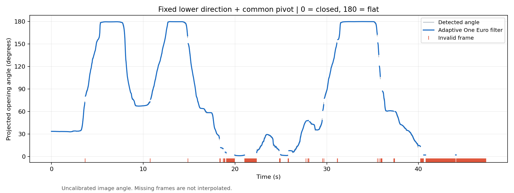
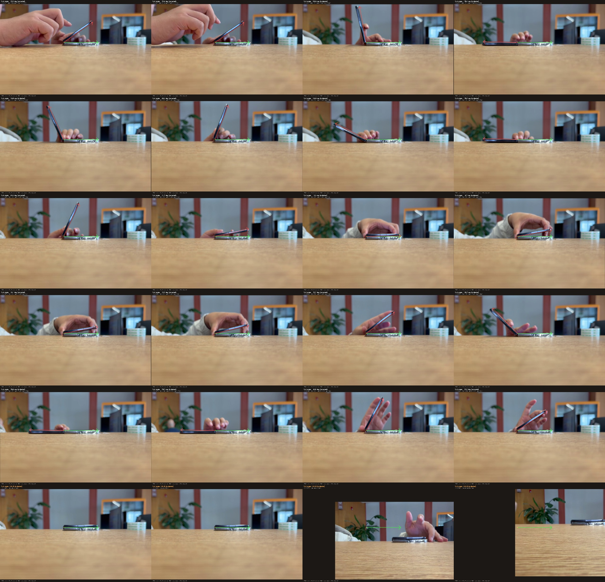
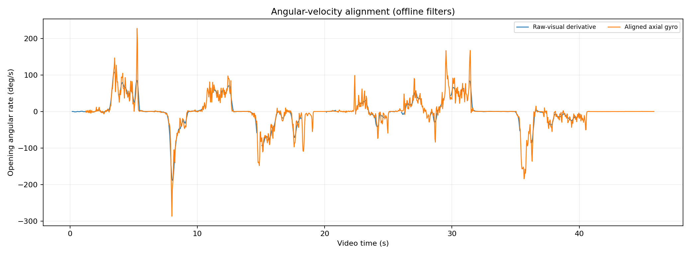
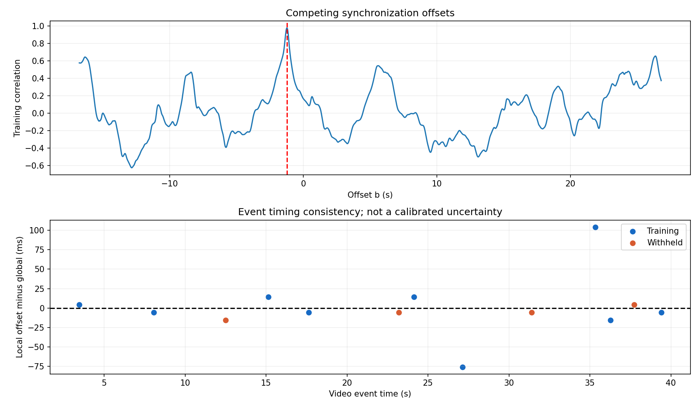
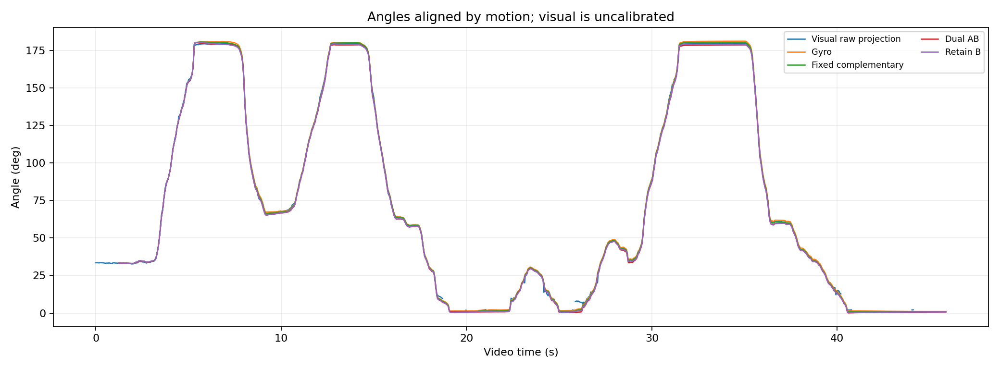
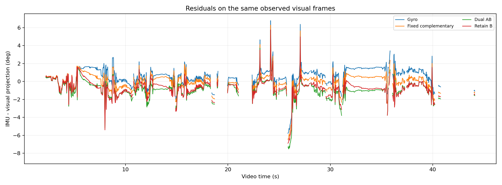
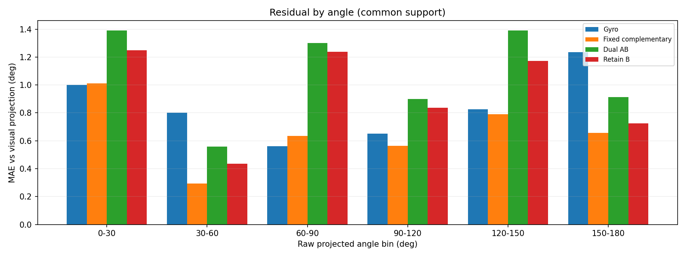
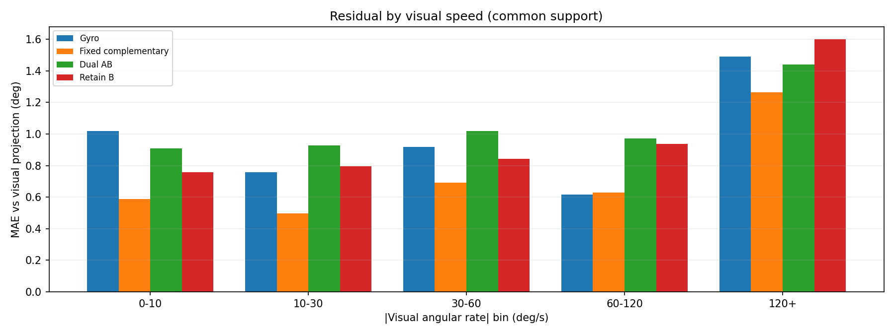
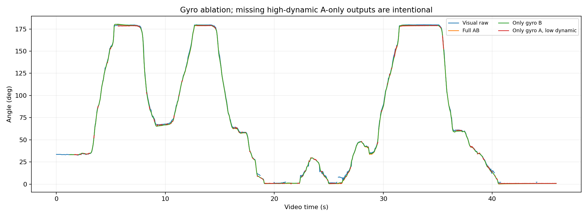

# 折叠手机视觉与双 IMU 同步实验分析

配套阅读：[从原始采集到最终结果的逐步原理说明](../../docs/2026-10-16-synchronized-experiment-principles.md)。该文按本次实际处理链解释每一步，并用原始采样演算一次接受/一次拒绝的重力校正，以及视频第 300 帧的同步插值与残差。

日期：2026-10-16。实验编号：experiment_20261016_110453。状态：已运行的离线真实数据实验；不是实时系统，不是机械角度精度认证。

## 1. 重点结论

本次从视觉原始投影角的导数与副机身轴向 gyro 建立了数据驱动的时间对应：`t_imu = t_video + (-1.217161) s`。零偏移相关性约 0.173，对齐后约 0.980，两者在共同支持样本上计算。保留 a=1；本次没有可靠识别时钟漂移，也没有独立同步触发可给出毫秒级精度保证。

IMU 与视觉比较使用有效的**原始二维投影角**，没有用 One Euro 显示角隐藏时序滞后，没有填补无效视觉帧。初始角 33.254° 来自重叠起点附近视频，之后 IMU 估计没有再接收视觉角校正，因此本实验属于同步对照，不是持续视觉融合。

下方提供共同支持上的完整指标及单 gyro 结果。仅保留固定侧 gyro 的方案只在低动态重力可用时输出角度，高动态缺测明确留空；不能用其较低的静止误差声称与动态双 gyro 等价。所有结果均不能证明任意手持可去掉一套 gyro。

## 2. 实验数据与审计

- 视频：`data/raw/1016110453.mp4`。
- IMU：`data/raw/sensor_log_2026-10-16_11-04-53.csv`。
- 分别启动、结束，文件名没有参与同步计算。
- 角度定义：闭合0°、半开90°、展开180°。方向来自铰链到自由端，可区分30°和150°。

### 视频

分辨率 1280×720，标称 30 fps，实际解码 1421 帧，与容器声明一致。名义时长 47.3667 s；首末解码帧为 0、1420，末帧名义时刻 47.333333 s。

OpenCV播放时间戳严格递增可用：True；与名义时间轴最大差为 7.105427357601002e-15 s。详细记录见 `video/frame_timestamps.csv`。测角仍采用帧号/fps名义轴。容器播放时间不等于相机曝光硬件时间，声明与解码帧数一致也不能排除采集端掉帧。

画面检查支持主要动作期间相机和下机身基本固定，上机身开合；视频末段存在相机重新摆位。当前只做平移配准，没有一般三维相机运动补偿。末段模板失配、边线缺失等状态不参与角度残差。

### IMU

| 数据流 | 原始行 | 独立时刻 | 重复行 | 冲突时刻 | dt中位数 ms | 最大间隔 ms |
|---|---:|---:|---:|---:|---:|---:|
| 加速度传感器 | 4956 | 4956 | 0 | 0 | 8.002 | 27.985 |
| 陀螺仪传感器 | 4461 | 4461 | 0 | 0 | 9.999 | 12.998 |
| gyro1 | 4461 | 4086 | 375 | 9 | 12.000 | 52.000 |
| acc1 | 4428 | 4102 | 326 | 6 | 12.000 | 91.000 |

原始总行数18306，去重后共17605条。去重按每路、每个整数纳秒时间戳保留最后一条，冲突不能恢复原有采样时间。原始文件不修改；去重原生长表保存在 `imu/cleaned_imu.csv`，保留原始整数时间及相对公共秒。没有把缓存重复写入视为新增样本。各路无时间倒退，存在采样间隔变化和动态异常；详细最大模长、间隔分位数与缺口见审计JSON。尤其副acc的冲击异常不能直接当作重力。

gyro单位rad/s沿用用户对硬件的确认；acc为m/s²依据静止约9.8的模长推断。主A对应中文两路，副B对应acc1/gyro1，是由时钟分组、主重力近固定、副gyro运动显著推断的身份映射，不是安装元数据的替代。副gyro主分量为第 1 轴（XYZ从0计），PCA轴约 [0.002046, 0.999965, -0.008168]，主成分能量占比 99.9319%。保留的副acc独立拟合重力旋转平面，其法向约 [0.002375, 0.999995, -0.001836]，两种证据一致支持+Y。算法输入轴由acc平面法向的主坐标确定，gyro PCA仅作核对，避免在屏蔽副gyro时从它间接生成轴输入。开启时副轴向角速度为负，与视频动作方向核对。

两种原始时钟域分别约1.79e18 ns与5.42e13 ns，先各自减整数参考点，再映射相对秒。主副IMU软件行序映射为 `t_common=1.000013369374*t_A+(-0.014183)`，其残差P5/P50/P95为 [-7.237, -0.078, 7.897] ms。这是记录顺序映射残差，不能当硬件同步精度；主副IMU映射与视频偏移是两个不同问题。

## 3. 视觉测角效果与修复

本次单独配置 `configs/experiment_20261016_110453.json`。初始开合约34°，没有套用旧实验的初始180°。新画面的固定下边指向右，与旧画面相反，因此增加显式镜像坐标适配：内部复用旧检测几何，输出边线、交点和配准量再转换回原图。这也修复了首轮探测中“角度数值正确、上边绘制到桌面下方”的问题。历史默认行为和配置不改写。

仍为手动首帧ROI、模板跟踪、受约束LSD边线与One Euro滤波，没有训练目标检测网络。固定虚拟交点为 [540.0, 305.0]，观测线段与模型射线分开导出。手机厚度允许真实边框不严格交于虚拟点。无相机/机械角度标定，输出只能称二维投影角。

1421帧中有效1118帧，无效303帧，可用比例78.68%。失败分布：{'angle_discontinuity': 126, 'upper_edge_not_found': 169, 'base_template_not_found': 8}。可用比例不是准确率。One Euro参数保持min_cutoff=.8Hz、beta=.1、derivative_cutoff=1Hz，无效后重置，不填角度。





## 4. IMU算法、初值与门控

本次调用已有 `estimate_angle` 单自由度实现；新增可显式传入已估计零偏的参数，旧调用默认行为保持不变。原脚本的五秒静止和180°假设在本次无效，相关早期试跑仅留在`_probes/invalid_legacy_initialization/`，不属于最终结果。

采用前约0—1s近似保持窗口，副gyro中位零偏 [0.00345, 0.0002, -0.00085] rad/s，主gyro零偏 [-0.00245, 0.00155, -0.0003] rad/s；窗口仍有轻微持握运动，其标准差和初始参考都保存在summary中。没有用全程角度残差拟合gyro零偏。初值仅由同步起点约0.4s原始视觉中位数建立，排除初始1s校准区间后再统计残差。

纯gyro按真实采样dt梯形积分：`theta_pred=theta_prev-.5*(omega_prev+omega_now)*dt`。低动态时用重力在垂直铰链轴平面内的相位构造角度，再以`K=1-exp(-dt/1s)`做互补校正。条件为模长偏差<.6m/s²、投影>.2g、jerk<30m/s³、去偏gyro模长<.25rad/s、角度创新<20°。没有卡尔曼滤波、端点吸附、角度缩放或强制范围裁剪。

当前固定底座校正标志计数 2347，暂定双IMU 2319，只保留副gyro 2319；首点dt=0的标志不等于非零修正。AB使用两侧加速度相位和轴向gyro差分，主轴暂按同向+Y，尚未独立安装标定；仅副gyro组保留两侧acc用于重力关系。

## 5. 时间同步方法及可信程度

从原始视觉角用11帧居中二次局部拟合求角速度，不使用One Euro输出。缺观测窗口不求导。副gyro先减上述零偏、投影到经本次检查的轴、符号取开启为正；用于匹配的gyro经过约.04s对称高斯平滑并限制冲击峰幅，原始gyro不因同步而被改写。

先对保留的训练动作做归一化互相关的偏移搜索，再在训练动作窗口细化。每第三个动作在粗搜和细化前预先留出，只做验证；这些仍来自同一次采集，不等价于外部同步真值。没有利用IMU角度曲线自证时间或角度正确性。

最终映射：`a=1，b=-1.217161s`。例如视频10s对应IMU约8.783s，说明IMU相对视频稍晚开始。可信重叠的运动支持范围为视频1.233—40.033s；范围内部仍有无效帧，必须读取各行有效标志。相关性从0.173升至0.980，训练动作9个，留出验证4个。

相似往返动作导致的竞争偏移已在全范围搜索中保留。是否存在相近强度的多解候选：False；最优训练候选相关约0.979，其他候选的时移和支持见time_alignment.json及诊断图。没有把每轮开合自由挪动到最有利的位置。

| 用途 | 视频动作峰 s | 方向 | 局部偏移 s | 局部相关 | 局部与全局差 ms | 峰值时间残差 ms |
|---|---:|---|---:|---:|---:|---:|
| 拟合 | 3.467 | opening | -1.213 | 0.947 | 4.2 | 10.5 |
| 拟合 | 8.067 | closing | -1.223 | 0.980 | -5.8 | -69.5 |
| 留出验证 | 12.500 | opening | -1.233 | 0.981 | -15.8 | -62.8 |
| 拟合 | 15.133 | closing | -1.203 | 0.985 | 14.2 | 3.8 |
| 拟合 | 17.633 | closing | -1.223 | 0.979 | -5.8 | 3.8 |
| 留出验证 | 23.200 | opening | -1.223 | 0.946 | -5.8 | -262.8 |
| 拟合 | 24.133 | closing | -1.203 | 0.852 | 14.2 | 43.8 |
| 拟合 | 27.133 | opening | -1.293 | 0.910 | -75.8 | -96.2 |
| 留出验证 | 31.400 | opening | -1.223 | 0.955 | -5.8 | 17.2 |
| 拟合 | 35.333 | closing | -1.113 | 0.998 | 104.2 | 未匹配 |
| 拟合 | 36.267 | closing | -1.233 | 0.980 | -15.8 | 30.5 |
| 留出验证 | 37.733 | closing | -1.213 | 0.966 | 4.2 | 103.8 |
| 拟合 | 39.400 | closing | -1.223 | 0.877 | -5.8 | -2.8 |

局部偏移与峰值残差既含同步误差，也含投影导数畸变、图像漏检、有限窗口平滑和接触冲击。峰匹配要求方向、顺序一致且不重复使用同一个gyro峰；没有对应峰时记录未匹配，不制造事件。若个别后段动作与统一偏移不一致，应视为该动作同步证据较弱，不能用自由漂移参数强行解释。候选偏移、相关曲线及所有事件保留在JSON，不单凭最大相关宣称成功。a保持1，本次不宣称识别出物理时钟漂移或达到毫秒级同步精度。





## 6. 共同时间轴的角度残差

以下参考是**未经几何标定的原始视觉投影角**。残差定义为IMU估计减视觉投影，不能解释为绝对机械角度误差。所有四条主要递推结果在相同有效视频帧、共同时间区间比较，共1051帧；参考初始化的前1s不参与评价。视觉缺失帧不补点，IMU插值不跨越超过阈值的缺口。

| 方法 | 样本数 | MAE ° | RMSE ° | P95绝对残差 ° | 最大绝对残差 ° | 平均偏差 ° |
|---|---:|---:|---:|---:|---:|---:|
| Gyro | 1051 | 0.927 | 1.222 | 1.709 | 7.015 | 0.554 |
| Fixed complementary | 1051 | 0.669 | 1.040 | 1.855 | 7.685 | -0.041 |
| Dual AB | 1051 | 1.049 | 1.423 | 2.503 | 8.396 | -0.910 |
| Retain B | 1051 | 0.910 | 1.278 | 2.313 | 8.106 | -0.736 |

固定互补相对纯gyro改善了平均残差，但P95与最大残差不一定同时改善，应按表中完整指标判断，不能仅凭MAE声称所有时刻都更好。

同时保留基于初始校准区间的明确常数偏移诊断，所减偏移为{'Gyro': 0.007449648537772191, 'Fixed complementary': 0.05832547313857006, 'Dual AB': 0.036428062777705605, 'Retain B': 0.05169423453970268, 'Retain A gravity': 0.13282558624364782}°；校正后指标另见metrics.json。未在评价区间偷偷平移或缩放曲线。误差按角度、速度、开启/闭合分别统计，见error_by_angle/error_by_speed和direction_metrics。速度分组还要求局部导数有效，因此样本数可能小于总表。









静止保持段要求视觉速度<3°/s并持续至少.7s，检测到4段。各段中位数/标准差和起末读数见`comparison/stability_and_drift.json`。起始并非闭合而末尾闭合，起末角差不能直接叫漂移；应看相对视觉残差的变化或相同机械状态的回返差异。

| 静止窗口 视频s | 视觉中位数 ° | 视觉std ° | 固定互补中位数 ° | 固定互补std ° |
|---|---:|---:|---:|---:|
| 5.47—7.40 | 179.370 | 0.153 | 180.289 | 0.302 |
| 9.27—10.13 | 67.469 | 0.257 | 66.774 | 0.359 |
| 12.83—14.23 | 179.573 | 0.045 | 180.038 | 0.051 |
| 31.70—35.00 | 179.661 | 0.081 | 180.194 | 0.013 |

开启和闭合的固定互补MAE分别为0.635°、0.590°；对应帧数231、225。这是当前速度与方向样本组成下的残差，并非完整动作的独立精度认证。

## 7. 固定底座单gyro消融

AB：Acc A+Gyro A+Acc B+Gyro B；仅B：Acc A+Acc B+Gyro B；仅A：Acc A+Gyro A+Acc B。没有训练神经网络。

屏蔽gyro通过独立接口在状态估计入口实现。仅A方案使用保留的accB原生事件时间和双acc相位，只在加速度模长、jerk、重力投影、由加速度计算的低相位变化率以及保留的gyroA通过门控时输出。没有把缺失gyroB假装为零积分，也没有从它取角速度、偏置、运动门控或更新时间。仅B组同样不访问gyroA。统一的离线时间标定与初始视觉角仅作为共享评估条件，不能误称无需标定的独立部署演示。

以下是**所有配置均有效的同一批帧**，共482帧，偏向低动态，不能代表快速开合：

| 方法 | 样本数 | MAE ° | RMSE ° | P95绝对残差 ° | 最大绝对残差 ° | 平均偏差 ° |
|---|---:|---:|---:|---:|---:|---:|
| Gyro | 482 | 0.973 | 1.198 | 1.636 | 7.015 | 0.691 |
| Fixed complementary | 482 | 0.631 | 0.920 | 1.326 | 7.685 | 0.048 |
| Dual AB | 482 | 0.980 | 1.299 | 2.283 | 8.396 | -0.903 |
| Retain B | 482 | 0.825 | 1.136 | 1.946 | 8.106 | -0.711 |
| Retain A gravity | 482 | 0.917 | 1.238 | 2.231 | 8.041 | -0.802 |

各配置自己的可用率与指标见`ablation/metrics.json`；不同可用率上的指标不能直接排名。在共同有效视觉参考帧中，AB和保留B可用率都是100.0%，仅保留A的低动态基线为45.9%。这是相对于可用参考的比例，不是全段传感器系统运行可用率。AB相对保留B的角度差中位数约-0.158°。保留B可以覆盖动态；保留A的高动态信息不足，明确拒绝输出。本次即使AB与保留B相近，也只支持固定底座条件：主gyro大多近静止，本来不提供很多额外相对运动信息。任意手持时公共运动不再近零，结论不可外推。



## 8. 系统性误差与目前不能得到的结论

可能的系统性来源包括：初始窗口的轻微运动使零偏估计受污染；小角速度偏置经积分累积；两侧安装轴和主副时钟尚未独立标定；视觉投影与机械角度并不完全相同；快速动作中的采样/曝光/滤波滞后；接触冲击与线性加速度污染重力参考；部分边框被手遮挡或反光导致方向切换。它们只能通过现有诊断建立证据，不能把全部残差归因于某一个来源。

本次固定互补的平均残差为-0.041°，双IMU为-0.910°，双IMU存在更明显的负偏差。增加两侧信息没有自动提高当前结果，主重力相位、主gyro偏置及未标定轴均可能引入附加偏差。

以下仅是**未应用的零偏敏感性诊断**，没有依据评价残差重新挑选零偏。给出在同一条纯积分轨迹上替换零偏的理论末值变化，说明初始化窗口为何重要：

| gyro零偏窗口 s | Y轴中位数 rad/s | 若替换当前零偏，纯积分末值变化 ° |
|---|---:|---:|
| 0.00—0.50 | 0.003250 | 7.806 |
| 0.00—1.00 | 0.000200 | 0.000 |
| 41.68—44.68 | 0.000500 | 0.768 |

另将时间偏移固定改为正负一视频帧进行诊断，结果保存在`comparison/systematic_diagnostics.json`，没有利用这些角度指标反过来优化同步。较快动作中即使时间误差仅一帧，也可产生显著角度残差；当前最大残差应结合动作速度和边框检测诊断，不能仅当作慢漂移。

当前建立的是数据驱动时间对应和角度对照流程，没有硬件同步真值，没有相机几何/独立机械角标定，也没有任意手持数据。首秒角度和同步来自同一视频，因此绝对初值不是独立测量。不能用本次静止std、可用率、互相关或软件测试精度替代真实角度精度。

## 9. 下一轮建议

记录真实传感器事件时间、设备身份、时钟域、序号、量程与安装轴，修复缓存重复写入；获取同步视频与独立编码器/标定角度参考。增加固定开合角整机转动、整机运动同时开合、铰链近竖直、快慢开合、不同初始角度、不同人员及持握位置。分别评价已知初始角跟踪与未知初值启动，覆盖长时漂移、遮挡和缺测恢复。

后续先建立完整双IMU物理基线，再比较两种单gyro配置与因果学习模型。训练/测试按独立会话、人员或设备划分，避免同轨迹重叠窗口泄漏。本次无训练结论。

## 10. 复现与验证

```powershell
Set-Location '<repo-root>'
python analyze_synchronized_experiment.py --video 'data/raw/1016110453.mp4' --imu 'data/raw/sensor_log_2026-10-16_11-04-53.csv' --config configs/experiment_20261016_110453.json --output outputs/experiment_20261016_110453 --rerun-video
python -m pytest tests -q
```

重复运行覆盖本次实验目录同名结果，历史目录不覆盖。清理/试跑文件不是最终证据，最终结果以本报告及manifest为准。所有原始文件SHA-256在运行前后核对，保持不变：True。标注视频实际解码1421帧，CSV行数1421；原始整数时间戳单调检查True。测试及逐项验证见`verification.json`，图像与数值都应结合报告边界解释。

### 本次最终核验记录

.............................                               [100%]
29 passed, 13 subtests passed in 5.03s

已独立核对全部必需交付文件、PNG格式与解码、清理数据等于原始同时间戳最后记录、整数时间单调性、CSV残差指标、模型射线几何、原始文件哈希及事件匹配顺序。独立gyro再积分最大数值差为1.208e-12°；该差值只验证数值实现一致，不是物理精度。
